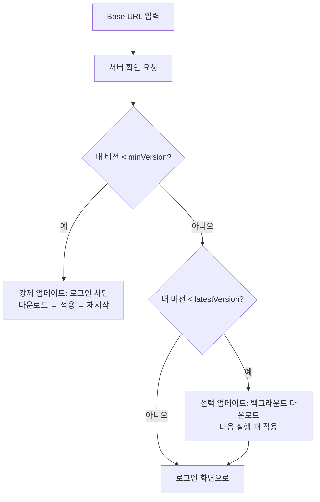

# 데스크톱 클라이언트 자동 업데이트

> 상태: 초안 · 갱신: 2026-10-21 · 관련: [ADR-0004](../adr/0004-velopack-auto-update.md), [authentication.md](../03-security/authentication.md)

## 목표

- 서버 버전과 클라이언트 버전이 어긋나서 API 호출이 깨지는 일을 막습니다.
- 관리자 권한이 없는 사내 PC에서도 업데이트가 됩니다.
- 인터넷이 막힌 망분리 환경에서도 동작합니다.

## 핵심 아이디어: 서버를 배포하면 맞는 클라이언트도 함께 배포됩니다

각 회사 서버가 **자기 버전과 맞는 클라이언트 패키지를 직접 제공**합니다. 릴리스 파이프라인은 서버와 클라이언트를 하나의 설치 번들로 묶습니다 ([deployment.md](deployment.md)).

```
GitHub Actions
  ├─ 서버 빌드·게시
  ├─ 클라이언트 빌드 → vpk pack (전체 패키지 + 이전 버전과의 차등 패키지)
  └─ 서버 설치 번들에 updates/win/ 포함
            ▼ 회사 IIS에 배포
https://erp.company.com/updates/win/releases.stable.json
```

## 버전 호환 확인 (로그인 전)

서버 확인 엔드포인트 `GET /.well-known/synthetix`의 응답 중 업데이트 관련 필드입니다 (전체 형식은 [authentication.md](../03-security/authentication.md)).

```json
{
  "serverVersion": "1.4.0",
  "client": {
    "minVersion": "1.3.0",
    "latestVersion": "1.4.0",
    "updateFeedUrl": "https://erp.company.com/updates/win/"
  }
}
```



- **업데이트 확인을 로그인보다 먼저 합니다.** 그래서 구버전 클라이언트가 인증 요청을 보내는 일 자체가 생기지 않습니다.
- 실행 중에도 일정 주기(예: 1시간)로 다시 확인하고, 새 버전이 있으면 "재시작하면 업데이트됩니다"라고 알립니다.
- 서버 API는 최소 **N-1 버전 클라이언트까지 호환**하도록 유지합니다. `minVersion`은 호환이 정말 깨질 때만 올립니다.
- 서버는 모든 API 응답에 `X-Synthetix-Min-Client-Version` 헤더를 넣습니다. 로그인한 상태에서 서버가 업그레이드돼도 클라이언트가 이를 알아챌 수 있습니다.

## 보안

| 위협 | 대응 |
|---|---|
| 위조된 업데이트 경로 | `updateFeedUrl`이 Base URL과 **같은 출처(scheme, host, port)인지** 확인합니다. 다르면 업데이트를 거부합니다 |
| 패키지 변조 | HTTPS를 쓰고, Velopack이 릴리스 목록에 있는 해시로 패키지를 검증합니다 |
| 발행자 위장 | Authenticode 코드 서명. 개발 중에는 자체 서명 인증서를 씁니다 (미결 사항 Q6) |
| 다운그레이드 공격 | 기본적으로 현재보다 낮은 버전으로는 업데이트하지 않습니다. 서버 롤백 때만 예외로 허용합니다 (아래 참고) |

## 롤백

서버를 이전 버전으로 되돌리면, 클라이언트도 그 버전을 받도록 합니다.

- 서버 확인 응답에 `"allowDowngrade": true`를 넣고, 클라이언트는 이 경우에만 낮은 버전 적용을 허용합니다. (확인 필요: Velopack의 다운그레이드 지원 방식)

## 설치와 채널

- Velopack 설치 프로그램은 관리자 권한 없이 `%LocalAppData%`에 사용자 단위로 설치합니다.
- 처음 설치할 때 쓰는 `Setup.exe`는 서버의 `/updates/win/`에서 내려받을 수 있게 둡니다. 웹 클라이언트 로그인 화면에 다운로드 링크를 표시합니다.
- 채널은 `stable` 하나로 시작합니다. 필요하면 `beta`를 추가합니다.

## 클라이언트 구현 메모

- `Program.Main` 맨 앞에서 `VelopackApp.Build().Run()`을 호출합니다.
- 공통 프로젝트에는 `IUpdateService` 인터페이스를 둡니다. Desktop은 Velopack 구현을, Browser는 아무것도 하지 않는 구현을 씁니다.
- 개발 중(디버거로 실행할 때)에는 업데이트 확인을 건너뜁니다.

## 웹(WASM) 클라이언트

서버를 배포하면 자동으로 최신 버전이 됩니다. 브라우저가 옛 파일을 쓰지 않도록 [deployment.md](deployment.md)의 캐시 정책만 지키면 됩니다. 이미 열려 있는 탭은 `X-Synthetix-Min-Client-Version` 헤더를 보고 새로고침을 안내합니다.
