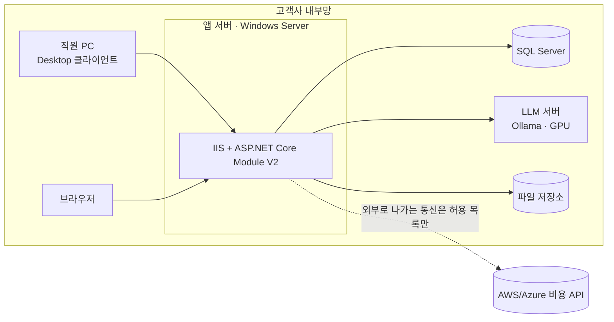

# 배포

> 상태: 초안 · 갱신: 2026-10-21 · 관련: [ADR-0002](../adr/0002-single-tenant-deployment.md), [client-update.md](client-update.md)

## 배포 형태 (설치형, 단일 테넌트)



- 앱 서버, DB, LLM은 한 대에 같이 둘 수도 있고 나눌 수도 있습니다. LLM은 GPU가 필요해서 보통 서버를 따로 둡니다.
- **서버에서 외부로 나가는 통신은 방화벽 허용 목록으로 제한합니다.** 클라우드 비용 API만 허용하는 식입니다. 애플리케이션의 AI 전송 정책과 함께 이중 방어가 됩니다.

## 설치 번들

릴리스 하나에 다음을 묶어서 배포합니다.

```
synthetix-server-{version}.zip
├─ app/                  # 게시된 ASP.NET Core 앱 (Synthetix.Server)
│  └─ wwwroot/           # Avalonia Browser(WASM) 정적 파일
├─ updates/win/          # Velopack 클라이언트 패키지 (client-update.md 참고)
├─ migrations/           # EF Core 마이그레이션 번들 (efbundle.exe), 모듈별
├─ deploy/               # web.config 템플릿, IIS 설정 스크립트(PowerShell)
└─ RELEASE-NOTES.md
```

## 설치와 업그레이드 절차

1. 사전 준비: Windows Server, IIS, ASP.NET Core Hosting Bundle(.NET 10), SQL Server, HTTPS 인증서
2. IIS 사이트를 만듭니다. 애플리케이션 풀은 "관리 코드 없음", 전용 ID로 실행합니다.
3. 설정을 입력합니다: 연결 문자열, JWT 서명 키 위치, LLM 엔드포인트, 파일 저장 경로
4. DB 마이그레이션 번들을 실행합니다. **앱이 시작될 때 자동으로 마이그레이션하지 않습니다.**
5. 앱 파일을 배포합니다. `app_offline.htm`을 이용해 무중단에 가깝게 교체합니다.
6. 처음 설치할 때는 초기 관리자 계정을 만드는 명령을 실행합니다 (`Synthetix.Server setup create-admin`, 예정)

## IIS 설정 주의점

| 항목 | 설정 |
|---|---|
| MIME 타입 | `.nupkg`(Velopack)는 IIS가 기본으로 막으므로 추가합니다. WASM 관련 확장자(`.wasm`, `.dat` 등)도 확인 후 필요하면 추가합니다 |
| 압축 | WASM 파일은 빌드할 때 미리 압축된 `.br`/`.gz`를 제공합니다. SSE 응답(AI 스트리밍)에는 동적 압축과 버퍼링을 끕니다 |
| 캐시 | `index.html`은 캐시하지 않습니다. 해시가 붙은 정적 파일은 오래 캐시합니다 |
| `/updates` | 인증 없이 정적 파일로 제공합니다 |
| HTTPS | HTTP는 HTTPS로 리다이렉트하고, HSTS를 적용합니다 |
| 요청 크기 | 계약서 업로드를 고려해 최대 크기를 설정합니다 (예: 50MB) |

## 설정과 비밀 값

- `appsettings.json`(기본값) → `appsettings.Production.json` → 환경변수 순서로 덮어씁니다.
- 비밀 값(DB 비밀번호, JWT 서명 키, 클라우드 자격 증명)은 저장소에 넣지 않습니다.
  - 설치형: 환경변수, 또는 Windows 인증서 저장소(서명 키)
  - 클라우드 비용 자격 증명은 DB에 암호화해서 저장합니다 ([data-protection.md](../03-security/data-protection.md))
- ASP.NET Data Protection 키 링은 파일 시스템에 저장하고, DPAPI로 보호합니다.

## Azure 확장 (Phase 4)

| 설치형 | Azure |
|---|---|
| IIS | App Service (Windows 또는 Linux) |
| SQL Server | Azure SQL Database |
| 파일 저장소 | Blob Storage |
| 인증서 저장소, 환경변수 | Key Vault |
| `/updates` | Blob Storage + CDN |
| Ollama 서버 | GPU VM에서 계속 자체 운영하거나, 정책상 허용하면 Azure OpenAI |
