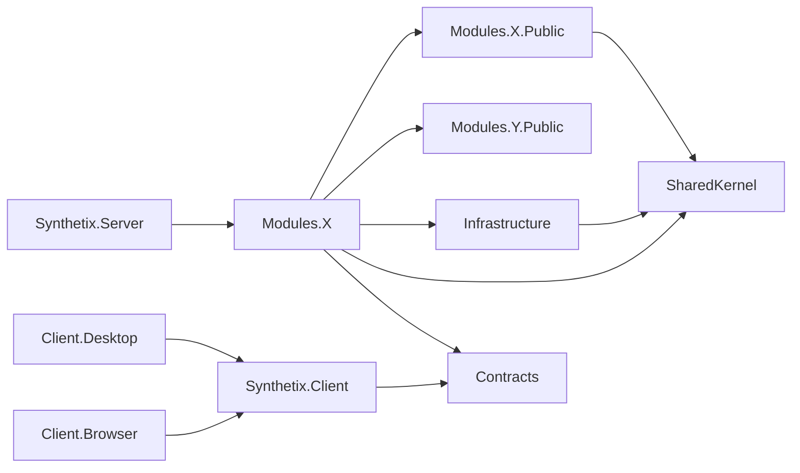

# 솔루션 구조

> 상태: 초안 · 갱신: 2026-10-21 · 관련: [ADR-0001](../adr/0001-modular-monolith.md)

## 폴더 구조

```
synthetix/
├─ AGENTS.md
├─ Synthetix.slnx
├─ global.json                     # .NET SDK 버전 고정
├─ Directory.Build.props           # 공통 빌드 설정 (Nullable, 경고를 오류로 처리 등)
├─ Directory.Packages.props        # 중앙 패키지 버전 관리
├─ .editorconfig
├─ docs/
├─ src/
│  ├─ Server/
│  │  ├─ Synthetix.Server/                     # ASP.NET Core 호스트: 모듈 조립, 미들웨어, IIS 진입점
│  │  ├─ Synthetix.SharedKernel/               # 도메인 공통 타입: Entity, Result, Error, DataClassification 특성
│  │  ├─ Synthetix.Infrastructure/             # 공통 인프라: EF Core 기반, Outbox, 감사, 암호화, 로그 가림, 파일 저장
│  │  └─ Modules/
│  │     ├─ Identity/
│  │     │  ├─ Synthetix.Modules.Identity/          # 모듈 구현 (internal)
│  │     │  └─ Synthetix.Modules.Identity.Public/   # 다른 모듈에 공개: IIdentityModule, 통합 이벤트
│  │     ├─ Projects/ (같은 구조)
│  │     ├─ HR/
│  │     ├─ Accounting/
│  │     ├─ Platform/
│  │     └─ AI/
│  ├─ Shared/
│  │  └─ Synthetix.Contracts/                  # 클라이언트와 서버가 공유: 요청·응답 DTO, 검증, JsonSerializerContext
│  └─ Client/
│     ├─ Synthetix.Client/                     # Avalonia 공통: Views, ViewModels, API 클라이언트, 서비스 인터페이스
│     ├─ Synthetix.Client.Desktop/             # Windows 진입점: Velopack, DPAPI 토큰 저장소
│     └─ Synthetix.Client.Browser/             # WASM 진입점: 브라우저용 토큰 저장
├─ tests/
│  ├─ Synthetix.Modules.{Name}.Tests/          # 모듈 단위 테스트
│  ├─ Synthetix.Server.IntegrationTests/       # WebApplicationFactory + Testcontainers(SQL Server)
│  ├─ Synthetix.ArchitectureTests/             # 모듈 경계와 참조 규칙 검사
│  ├─ Synthetix.Client.Tests/                  # ViewModel 테스트, Avalonia.Headless
│  └─ Synthetix.AI.Evals/                      # AI 평가셋 (CI 기본 실행에서는 제외)
├─ tools/                                      # 개발 도구: ddl/Test-Ddl.ps1 (DDL 검증), ErdGenerator (예정)
├─ deploy/                                     # IIS 설정, 설치 스크립트, 번들 구성
└─ .github/workflows/
```

## 프로젝트 참조 규칙



| 규칙 | 검사 방법 |
|---|---|
| 모듈은 다른 모듈의 구현 프로젝트를 참조하지 않습니다. `.Public`만 참조합니다 | 아키텍처 테스트 |
| `.Public`에는 인터페이스, 통합 이벤트, 단순 DTO만 둡니다. EF Core 같은 인프라 의존성은 넣지 않습니다 | 아키텍처 테스트 |
| `Contracts`는 외부 의존성이 없습니다. 클라이언트(WASM)도 참조해야 하기 때문입니다 | 프로젝트 파일 검토 |
| 클라이언트는 서버 프로젝트를 참조하지 않습니다 | 아키텍처 테스트 |
| 모듈 구현 타입은 기본적으로 `internal sealed`로 만듭니다 | 코드 리뷰, 분석기 |

## 모듈 내부 구조 (기능 단위 수직 분할)

```
Synthetix.Modules.Projects/
├─ ProjectsModule.cs             # 서비스 등록(AddProjectsModule)과 엔드포인트 매핑(MapProjectsEndpoints)
├─ Domain/                       # 엔티티, 값 객체, 도메인 규칙. 인프라 의존 없음
│  ├─ Contracts/Contract.cs
│  └─ Projects/Project.cs
├─ Features/                     # 기능 하나 = 폴더 하나
│  ├─ CreateProject/
│  │  ├─ CreateProjectEndpoint.cs
│  │  └─ CreateProjectHandler.cs
│  └─ GetProjectList/
├─ Infrastructure/
│  ├─ ProjectsDbContext.cs       # 기본 스키마는 "projects"
│  ├─ Configurations/            # IEntityTypeConfiguration
│  └─ Migrations/
└─ IntegrationEvents/            # 다른 모듈 이벤트를 처리하는 핸들러
```

- 요청 DTO와 응답 DTO는 `Synthetix.Contracts/{Module}/`에 둡니다. 엔드포인트는 Contracts 타입만 입력받고 반환합니다.
- 핸들러는 일반 클래스로 만들어 DI에 등록하고, 엔드포인트에서 직접 호출합니다. MediatR 같은 중재자 라이브러리는 쓰지 않습니다.
- 기능 폴더 하나에 필요한 코드가 모두 모여 있습니다. 그래서 에이전트는 한 폴더만 읽고 그 기능을 이해할 수 있습니다.
