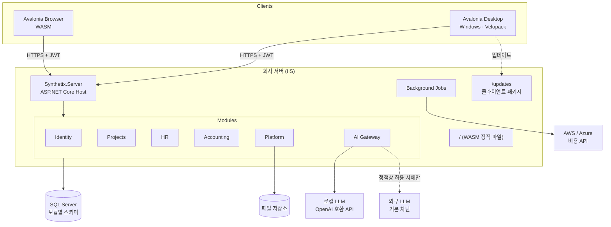

# 시스템 개요

> 상태: 초안 · 갱신: 2026-10-21 · 관련: [ADR-0001](../adr/0001-modular-monolith.md), [ADR-0002](../adr/0002-single-tenant-deployment.md)

## 구성도



## 핵심 특징

- **모듈형 모놀리스입니다.** 배포 단위는 하나지만 모듈 경계는 엄격하게 지킵니다. ([ADR-0001](../adr/0001-modular-monolith.md))
- **회사별 설치형, 단일 테넌트입니다.** 한 번 설치하면 한 회사만 씁니다. 그래서 테넌트 ID 같은 개념이 없습니다. ([ADR-0002](../adr/0002-single-tenant-deployment.md))
- **C#으로 풀스택을 구성합니다.** 서버와 클라이언트가 `Synthetix.Contracts`(DTO와 검증 규칙)를 함께 씁니다.
- **AI 호출은 한 곳으로만 나갑니다.** 모든 LLM 호출이 AI Gateway를 거칩니다. ([ai-gateway.md](../04-ai/ai-gateway.md))

## 모듈 책임

| 모듈 | 책임 | DB 스키마 |
|---|---|---|
| Identity | 사용자 계정, 로그인, MFA, 토큰, 역할·역할 부여, 유효 권한 계산 (조직 프로젝션 유지) | `iam` |
| Projects | 고객사, 계약, 프로젝트, 일정(WBS), 투입(M/M), 기성 | `projects` |
| HR | 조직 구조·조직개편·조직도, 직원, 고용 형태, 근로 계약, 파견, 기술·경력 | `hr` |
| Accounting | 계정과목, 전표, 매출·매입, 프로젝트 손익, 클라우드 비용 | `accounting` |
| Platform | 알림, 파일 저장, 공통 코드, 시스템 설정, 감사 로그 조회 | `platform`, `audit` |
| AI | AI Gateway, 비식별화, 검열, 프롬프트 관리, AI 감사, 벡터 인덱스 | `ai` |

## 모듈 사이의 통신

| 방식 | 언제 쓰는가 | 예 |
|---|---|---|
| 동기 호출: `I{Name}Module` 인터페이스 (`.Public` 프로젝트) | 다른 모듈의 데이터를 **조회**할 때 | Accounting이 Projects에서 프로젝트 코드를 확인 |
| 통합 이벤트 (Outbox) | 다른 모듈의 **상태 변화에 반응**할 때 | HR의 `EmployeeTerminated` 이벤트를 받아 Projects가 투입을 종료 |

- 통합 이벤트는 같은 트랜잭션 안에서 `outbox` 테이블에 저장합니다. 이후 백그라운드 디스패처가 꺼내서 전달합니다(최소 1회 전달). 그래서 받는 쪽은 **같은 이벤트를 두 번 받아도 문제가 없어야 합니다(멱등성)**.
- 다른 모듈의 테이블을 JOIN하지 않습니다. 화면에 필요한 조합은 Application 계층에서 만들거나, 읽기 전용 View로 따로 설계합니다.

## 요청 처리 흐름

```
HTTP 요청
 → 요청 제한(Rate Limiter), 인증(JWT 검증)
 → 엔드포인트 (Features/{Feature}/Endpoint)
 → 권한 정책 확인 (permission)
 → 입력 검증
 → 핸들러: 도메인 로직, 데이터 범위 적용
 → DbContext SaveChanges (감사 컬럼, 감사 로그, Outbox 저장)
 → 응답 DTO (Contracts) 또는 ProblemDetails
```

## 횡단 관심사

| 관심사 | 방식 |
|---|---|
| 로깅 | Serilog 구조화 로그. 민감 필드는 자동으로 가립니다 ([data-protection.md](../03-security/data-protection.md)) |
| 감사 | 누가·언제·무엇을 바꿨는지 `audit` 스키마에 저장. 민감정보 열람도 기록합니다 |
| 오류 | RFC 9457 ProblemDetails, 오류 코드는 `{module}.{error}` 형식 ([api-conventions.md](../05-api/api-conventions.md)) |
| 설정 | `appsettings.json` + 환경별 파일 + 환경변수. 비밀 값은 저장소에 넣지 않습니다 |
| 시간 | `TimeProvider` 주입. 저장은 UTC, 화면 표시는 Asia/Seoul |
| 백그라운드 작업 | Hangfire (SQL Server 저장소): 클라우드 비용 수집, 만료 알림, Outbox 전달 |
| 파일 | `IFileStorage` 추상화. 설치형은 로컬 디스크, 클라우드에서는 Blob Storage |
