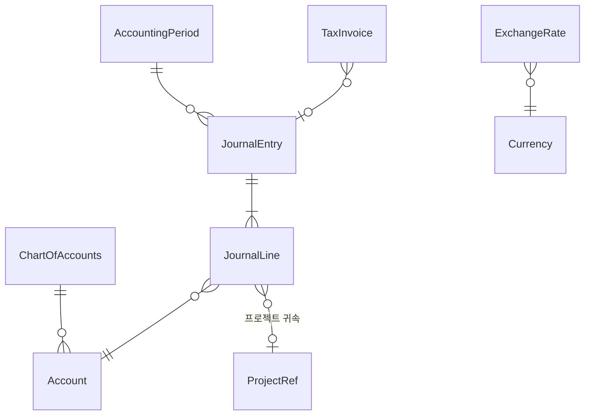

# 도메인: 회계 (Accounting 모듈)

> 상태: 초안 · 갱신: 2026-10-21 · 용어: [glossary.md](../00-overview/glossary.md) · 관련: [cloud-cost.md](cloud-cost.md) · ERD: [accounting](../06-data/erd/accounting.md)

## 범위

- **포함:** 계정과목, 전표(복식부기), 전표 승인, 매출 청구(기성), 매입(외주비, 클라우드 비용), 프로젝트 손익, 회계 기간 마감, 환율
- **제외:** 재무제표 공시용 결산, 세무 신고, 전자세금계산서 발행 연동. 세금계산서는 **발행 기록만** 관리합니다.

## 개념 모델



## 전표 (JournalEntry)

- **차변 합계와 대변 합계가 같아야 합니다.** 이 규칙은 도메인에서 확인합니다.
- 상태: `Draft` → `Submitted` → `Approved` → `Posted`. 반려되면 `Rejected`
  - 작성자와 승인자는 다른 사람이어야 합니다(직무 분리).
- **`Posted` 상태가 된 전표는 고치거나 지우지 않습니다.** 정정이 필요하면 역분개 전표를 새로 만듭니다.
- 전표의 각 줄(`JournalLine`)에는 프로젝트 코드를 넣을 수 있습니다. 프로젝트 손익은 이 값을 기준으로 집계합니다.
- 다른 모듈의 이벤트로 만들어지는 전표(예: `MilestoneAccepted` → 매출 전표)는 항상 `Draft`로 만들고, 사람이 승인해야 확정됩니다.

## 금액과 통화

- 금액 타입은 `decimal`이고, DB에서는 `decimal(19,4)`입니다. `double`이나 `float`는 쓰지 않습니다.
- 기능 통화(장부의 기준 통화)는 KRW입니다.
- 외화(클라우드 비용의 USD 등)는 원래 통화 금액, 적용 환율, 환산한 KRW 금액을 모두 저장합니다.
- 환율은 일자별 `ExchangeRate` 테이블에 둡니다. 어느 시점의 환율을 쓸지(거래일, 청구일 등)는 회계 정책으로 설정합니다.
- 반올림은 원 단위 `MidpointRounding.AwayFromZero`(사사오입)가 기본입니다 (확인 필요).

## 회계 기간 마감

- 월 단위로 마감합니다. 마감한 기간에는 전표를 새로 넣거나 고칠 수 없습니다.
- 마감을 해제하려면 `AccountingManager` 권한이 필요하고, 감사 로그가 남습니다.

## 프로젝트 손익

```
프로젝트 손익 = 매출(전표)
             − 인건비 원가 (투입 M/M × 표준 단가, Projects와 HR 데이터로 계산)
             − 외주비 (매입 전표)
             − 클라우드 비용 (배분된 금액, cloud-cost.md)
             − 기타 직접비 (전표)
```

- 인건비 원가는 전표가 아니라 **관리회계용 계산 값**입니다. 월말에 스냅샷으로 저장합니다.
- 화면에는 예산(계약 기준)과 실적을 나란히 보여줍니다. AI-ACC-03이 경영진용 요약을 만듭니다.

## 다른 모듈에서 받는 통합 이벤트

| 이벤트 | 처리 |
|---|---|
| `MilestoneAccepted` (Projects) | 청구 예정을 등록하고 매출 전표 초안을 만듭니다 |
| `AssignmentChanged` (Projects) | 인건비 원가를 다시 계산하도록 표시합니다 |
| `CostRateChanged` (HR) | 위와 같습니다 |
| `ProjectCodeChanged` (Projects) | 클라우드 비용 배분 규칙을 갱신합니다 |
