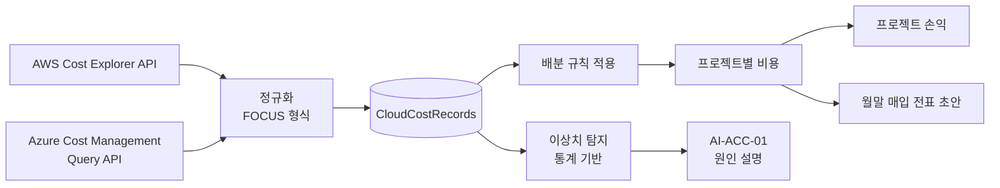

# 도메인: 클라우드 비용 (Accounting 모듈 하위 영역)

> 상태: 초안 · 갱신: 2026-10-21 · 관련: [accounting.md](accounting.md) · ERD: [accounting](../06-data/erd/accounting.md)

## 목표

AWS와 Azure의 비용을 매일 수집하고, 프로젝트별로 배분합니다. 그 결과를 프로젝트 손익에 반영하고, 비정상적인 비용 증가를 빨리 알아챕니다.

- 범위: 회사 내부의 원가 배분만 합니다. 고객사에 다시 청구하는 MSP 모델은 확장 항목입니다 (미결 사항 Q9).

## 흐름

## 연결 (CloudAccountConnection)

| 공급자 | 연결 단위 | 필요한 권한 (최소 권한) |
|---|---|---|
| AWS | 계정, 또는 조직의 관리 계정 | IAM 정책에 `ce:GetCostAndUsage`, `ce:GetDimensionValues`, `ce:GetTags`만 허용 |
| Azure | 구독 또는 청구 범위 | 서비스 주체에 `Cost Management Reader` 역할 |

- 자격 증명은 DB에 암호화해서 저장합니다 ([data-protection.md](../03-security/data-protection.md)). 화면에는 마지막 4자리만 보여줍니다.
- 서버에서 외부로 나가는 통신 허용 목록에 해당 API 엔드포인트를 추가해야 합니다 ([deployment.md](../01-architecture/deployment.md)).

## 수집

- Hangfire 작업이 매일 새벽에 실행됩니다. 직전 며칠치를 **다시 수집해서 덮어씁니다.** 클라우드 비용은 며칠 동안 계속 확정되기 때문입니다.
- AWS Cost Explorer API는 요청마다 요금이 붙습니다. 그래서 요청 수를 최소화하고 결과를 캐시합니다.
- 규모가 커지면 API 대신 파일 내보내기(AWS Data Exports, Azure Cost Exports)를 읽는 방식으로 바꿀 수 있습니다. 이를 위해 수집 방식을 인터페이스로 추상화해 둡니다.

## 정규화 모델: FOCUS 기반

FinOps Foundation의 **FOCUS** 명세에서 필요한 컬럼만 가져와 공통 모델로 씁니다.

| 컬럼 | 설명 |
|---|---|
| `Provider` | AWS, Azure |
| `BillingAccountId`, `SubAccountId` | AWS 계정, Azure 구독 |
| `ChargePeriodStart`, `ChargePeriodEnd` | 일 단위 |
| `ServiceName`, `ServiceCategory` | 예: Amazon EC2 / Compute |
| `RegionId` | |
| `ResourceId` | 리소스 단위로 수집하는 경우 |
| `BilledCost`, `EffectiveCost`, `BillingCurrency` | 원래 통화 금액 |
| `Tags` | JSON |

## 프로젝트 배분 규칙 (우선순위 순서)

1. **태그:** 리소스 태그 `synthetix:project = PRJ-2026-0007`
2. **계정·구독 매핑:** 계정이나 구독 하나를 프로젝트 하나에 매핑
3. **비율 배분:** 공용 리소스(예: 공용 VPN)를 정해진 비율로 나눔
4. **미배분:** 위 규칙에 해당하지 않는 비용은 "미배분"으로 모읍니다. 대시보드에서 미배분 비율을 관리 지표로 보여줍니다.

## 예산과 이상치

- 프로젝트별, 계정별로 월 예산을 두고 80%, 100%를 넘으면 알립니다.
- 이상치 탐지는 **통계 기반**입니다. 예: 최근 14일 이동평균 + 표준편차, 요일 효과 반영
- 이상치가 나오면 AI-ACC-01이 서비스와 리소스별 변동을 근거로 원인 추정을 설명합니다. 탐지 자체에는 LLM을 쓰지 않습니다.
