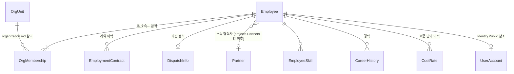

# 도메인: 인사 (HR 모듈)

> 상태: 초안 · 갱신: 2026-10-21 · 용어: [glossary.md](../00-overview/glossary.md) · ERD: [hr](../06-data/erd/hr.md)

## 범위

- **포함:** 직원 정보, 조직 구조와 조직도([organization.md](organization.md)), 고용 형태, 근로 계약 이력, 파견, 협력사 인력, 기술·경력, 표준 단가, 계약 만료 관리
- **제외:** 급여 계산, 4대보험 신고, 근태 관리 (미결 사항 Q12)

## 개념 모델

## 고용 형태 (EmploymentType)

| 값 | 의미 | 기간 제한 관리 |
|---|---|---|
| `Regular` | 정규직 | 없음 |
| `FixedTerm` | 기간제(계약직) 근로자 | 기간제법: 2년을 넘겨 쓰면 기간의 정함이 없는 근로자로 봅니다 |
| `Dispatched` | 파견 근로자 (파견사업주 소속, 우리 회사가 사용사업주) | 파견법: 최대 2년. 허용 업무 확인 필요 |
| `Freelancer` | 개인 프리랜서 (용역 계약) | 계약 기간 |
| `PartnerStaff` | 협력사 소속 외주 인력 | 협력사와의 매입 계약 기간 |

- **"파견"과 "상주"는 다른 개념입니다.** 우리 직원이 고객사에서 일하는 것(SI 업계에서 흔히 "파견"이라고 부르는 것)은 투입의 근무 장소 `OnSite`로 표현합니다. 법적 파견과 섞지 않습니다. (미결 사항 Q8)

## 계약 만료 규칙 엔진

LLM이 아니라 **코드로 된 규칙**입니다. 매일 실행하는 백그라운드 작업이 계산합니다.

| 규칙 ID | 조건 | 알림 시점 |
|---|---|---|
| HR-R01 | 기간제 근로자의 누적 사용 기간이 2년에 가까워짐 (계약 갱신 이력을 모두 합산) | 90, 60, 30일 전 |
| HR-R02 | 파견 근로자의 파견 기간이 2년에 가까워짐 | 90, 60, 30일 전 |
| HR-R03 | 근로 계약, 프리랜서 계약, 협력사 계약의 종료일이 다가옴 | 30, 14일 전 |
| HR-R04 | 계약이 끝났는데 아직 프로젝트에 투입되어 있음 | 즉시 |

- 알림은 Platform 모듈의 알림 기능으로 인사 담당자와 해당 PM에게 보냅니다.
- AI-HR-01은 이 결과를 받아 **대응 방안 설명과 통지문 초안**만 만듭니다.
- 법 규정의 세부 사항(예외 사유, 허용 업무 목록)은 구현하기 전에 법령을 확인합니다 (확인 필요). 규칙 엔진에는 **"법률 자문을 대체하지 않음"** 안내를 표시합니다.

## 기술·경력

- `Skill`은 Platform의 공통 코드로 관리합니다. 예: Java, Spring, .NET, Oracle, AWS
- 직원별로 숙련도(1~5)와 경력 연수를 둡니다.
- `SkillLevel`(초급·중급·고급·특급)은 업계 관행상 쓰는 등급입니다. 견적과 단가를 정하는 데 참고합니다.
- 협력사 인력의 경력기술서는 AI-HR-03이 파싱하고, 사람이 검토한 뒤 저장합니다.

## 표준 단가 (CostRate)

- 직원별, 기간별로 월 단가를 둡니다. 프로젝트 인건비 원가(= M/M × 단가)를 계산할 때 씁니다.
- 단가는 `Confidential` 등급입니다. 실제 급여(`Restricted`)와는 다른 값입니다.

## 민감정보

| 필드 | 등급 | 처리 |
|---|---|---|
| 이름, 연락처, 이메일 | Confidential | 권한 범위 안에서 조회 |
| 주민등록번호 | Restricted | 암호화. 원문은 별도 API로만 조회하고 감사 기록. AI 전송 금지 ([data-protection.md](../03-security/data-protection.md)) |
| 계좌번호 | Restricted | 위와 같음 |
| 단가 | Confidential | |

## 다른 모듈로 보내는 통합 이벤트

| 이벤트 | 받는 쪽 |
|---|---|
| `EmployeeHired` | Identity (계정 생성 대기 목록) |
| `EmployeeTerminated` | Identity (계정 비활성화, 세션 폐기), Projects (투입 종료) |
| `CostRateChanged` | Accounting (인건비 원가 다시 계산) |
| 조직 관련 이벤트 | [organization.md](organization.md) 참고 |
