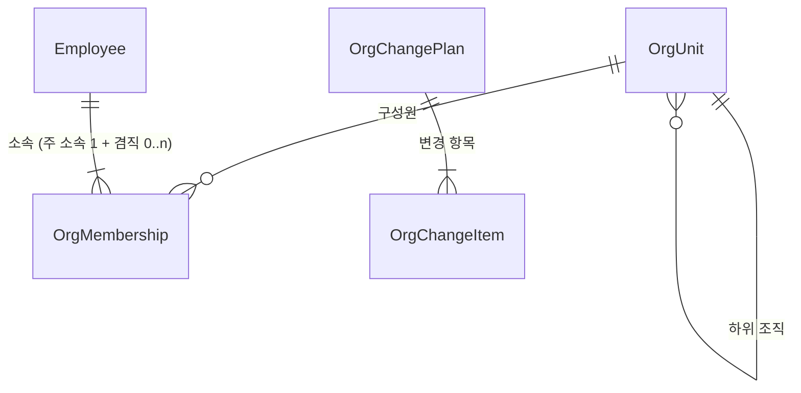
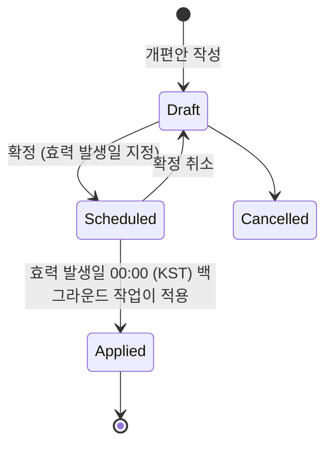

# 도메인: 조직 (HR 모듈)

> 상태: 초안 · 갱신: 2026-10-21 · 관련: [hr.md](hr.md), [authorization.md](../03-security/authorization.md), [ADR-0007](../adr/0007-org-based-access-control.md) · ERD: [hr](../06-data/erd/hr.md)

조직 구조는 HR 모듈이 관리합니다. 다만 다른 모듈들도 이 구조를 기준으로 씁니다.

- **권한 계산:** 조직 단위로 역할을 부여하고, 데이터 범위를 정합니다.
- **프로젝트:** 담당 조직을 정합니다.
- **회계:** 조직을 비용 귀속 단위(코스트센터)로 씁니다.

## 범위

- 조직 단위 트리 (회사 > 본부 > 부서 > 팀)
- 소속: 주 소속과 겸직, 조직장
- 조직개편: 효력 발생일을 정해 예약하고, 미리보기와 영향 분석을 한 뒤 적용
- 조직도 다이어그램: DB와 연결된 조회·편집 화면, 과거·미래 시점 보기
- 초기 세팅: 설치 직후 시스템 관리자가 CSV나 Excel로 가져오기

## 개념 모델

### 조직 단위 (OrgUnit)

| 속성 | 설명 |
|---|---|
| `Code` | 조직 코드. 유니크하고 **바꿀 수 없습니다.** 다른 모듈이 참조하고 코스트센터로도 쓰기 때문입니다. 이름은 바꿀 수 있습니다 |
| `Name` | 조직명 |
| `Type` | `Company`(회사), `Division`(본부), `Department`(부서), `Team`(팀) |
| `ParentId`, `Node` | 부모 조직, 그리고 SQL Server `hierarchyid` 값 (하위 조직 조회에 사용) |
| `SortOrder` | 같은 부모 아래에서 표시하는 순서 |
| `Status` | `Active`, `Closed`(폐지). 폐지한 조직은 삭제하지 않습니다. 이력 때문입니다 |

### 소속 (OrgMembership)

| 속성 | 설명 |
|---|---|
| `EmployeeId`, `OrgUnitId` | |
| `IsPrimary` | 주 소속 여부. 재직자는 **주 소속이 정확히 하나**여야 합니다. 나머지는 겸직입니다 |
| `JobTitle` | 이 소속에서 맡은 직책. 예: 팀장, 파트장 |
| `IsHead` | 이 조직의 조직장 여부. **조직 하나에 조직장은 최대 한 명**입니다. 겸직으로 조직장을 맡을 수도 있습니다 |
| `StartDate`, `EndDate` | 소속 기간 |

## 도메인 규칙

| 규칙 | 처리 |
|---|---|
| 루트(`Company`)는 하나뿐 | 금지 |
| 순환 구조 (자기 하위 조직 밑으로 옮기기) | 금지 |
| 기본 계층 순서(회사 > 본부 > 부서 > 팀)를 거스름 (예: 팀 아래에 본부) | 금지. 중간 단계를 건너뛰는 것(회사 바로 아래 팀)은 허용 |
| 구성원이나 하위 조직이 남아 있는 조직의 폐지 | 금지. 먼저 옮겨야 합니다 |
| 재직자인데 주 소속이 없음 | 금지 |
| 조직장이 없는 조직 | 허용. 조직도에 "공석"으로 표시 |

## 조직개편 (OrgChangePlan)

조직 변경은 대부분 **특정 날짜(예: 1월 1일)에 한꺼번에** 일어납니다. 그래서 변경 사항을 바로 적용하지 않고 "개편안"으로 모았다가, 효력 발생일에 적용합니다.

- 변경 항목 종류
  - 조직: 신설, 이름 변경, 이동, 폐지
  - 구성원: 소속 이동, 겸직 추가·해제, 조직장 지정·해제
- 확정하기 전에 두 가지를 보여줍니다.
  - **미리보기:** 개편 전후 조직도를 비교해서 보여줍니다.
  - **권한 영향 분석:** 이 개편으로 권한이 바뀌는 사용자와 그 내용을 보여줍니다 ([authorization.md](../03-security/authorization.md)의 권한 시뮬레이션).
- 적용은 **트랜잭션 하나**로 합니다. 하나라도 실패하면 전체를 취소하고 관리자에게 알립니다.
- 작은 변경(신규 입사자 배치 등)은 효력 발생일을 오늘로 정해서 바로 적용할 수 있습니다. 이 경우에도 같은 경로를 거칩니다.

### 이력 조회

- `OrgUnit`과 `OrgMembership`은 **시스템 버전 임시 테이블**입니다. 그래서 `asOf` 날짜를 주면 과거 시점의 조직도를 조회할 수 있습니다.
- 미래 시점은 현재 조직에 예약된 개편안을 적용해서 계산합니다.

## 조직도 다이어그램

### 기능

| 기능 | 설명 |
|---|---|
| 조회 | 전체 트리. 펼치기와 접기, 확대·축소, 화면 이동, "내 위치로" 이동 |
| 검색 | 조직명이나 이름으로 찾으면 그 노드로 이동해서 강조합니다 |
| 노드 카드 | 조직 카드: 조직명, 조직장, 인원 수. 구성원 카드: 이름, 직급, 직책, 고용 형태 배지(계약직, 파견, 협력사) |
| 필터 | 고용 형태별, 협력사·파견 인력 포함 여부, 겸직 표시 여부 |
| 시점 선택 | 과거 날짜(이력)나 예약된 개편안(미래)을 기준으로 봅니다 |
| 편집 모드 | `hr.organization.manage` 권한이 있을 때만. 조직과 구성원을 드래그해서 옮기면 **개편안 초안에 변경 항목으로 쌓입니다**. 즉시 반영되지 않습니다 |
| 권한 보기 모드 | 조직마다 부여된 역할을 겹쳐서 보여줍니다. 노드를 누르면 직접 부여된 역할과 상속된 역할을 볼 수 있습니다 ([authorization.md](../03-security/authorization.md)) |
| 내보내기 | PNG. PDF는 나중에 지원합니다 |

- 레이아웃: 조직은 위에서 아래로 이어지는 트리로 그립니다. 팀의 구성원은 **세로 목록으로 쌓아서** 화면 폭이 지나치게 넓어지지 않게 합니다.
- 공개 범위: 조직 구조, 이름, 직급, 직책은 `Internal` 등급이라 전 직원이 볼 수 있습니다. 연락처와 고용 세부 정보는 권한에 따라 보입니다 (미결 사항 Q16).

### API

| API | 설명 |
|---|---|
| `GET /api/v1/hr/org-chart?asOf=&rootUnitId=&depth=&planId=` | 노드를 **평평한 목록**(`id`, `parentId`, `kind` 등)으로 돌려줍니다. 트리는 클라이언트가 만듭니다. 조직이 크면 `depth`를 정해 일부만 받고, 펼칠 때 나머지를 받습니다 |
| `POST /api/v1/hr/org-change-plans` | 개편안을 만듭니다 |
| `POST /api/v1/hr/org-change-plans/{id}/items` | 변경 항목을 추가합니다 (편집 모드에서 드래그하면 호출) |
| `GET /api/v1/hr/org-change-plans/{id}/preview` | 개편 후의 조직도와 권한 영향 분석 결과 |
| `POST /api/v1/hr/org-change-plans/{id}/schedule` | 개편안을 확정합니다 |

클라이언트 구현은 [avalonia-conventions.md](../07-client/avalonia-conventions.md)의 "조직도 컨트롤"을 참고합니다.

## 초기 세팅 (시스템 관리자)

설치 직후 `create-admin` 명령으로 만든 첫 시스템 관리자가 **초기 설정 마법사**를 진행합니다.

1. **회사 정보:** 루트 조직(`Company`)을 만듭니다.
2. **조직과 직원 가져오기:** CSV나 Excel 템플릿을 올립니다.
   - 먼저 **시험 실행(dry-run)**으로 검증 결과만 보여줍니다: 오류, 경고, 새로 만들 건수
   - 확인하면 실제로 반영합니다.
3. **역할 부여:** 조직, 조직장, 개인 단위로 역할을 부여합니다 ([authorization.md](../03-security/authorization.md)).
4. **계정 활성화:** 직원별 초기 비밀번호를 발급합니다. 첫 로그인 때 비밀번호 변경과 MFA 등록을 강제합니다.

### 가져오기 템플릿 (초안)

| 시트 | 컬럼 |
|---|---|
| 조직 | `조직코드`, `조직명`, `유형`, `상위조직코드`, `정렬순서` |
| 직원 | `사번`, `이름`, `직급`, `고용형태`, `입사일`, `이메일` |
| 소속 | `사번`, `조직코드`, `주소속여부`, `직책`, `조직장여부` |

- 다시 가져와도 결과가 같아야 합니다(멱등). 조직코드와 사번을 키로 삼아, 있으면 갱신하고 없으면 만듭니다.
- 주민번호 같은 `Restricted` 필드는 가져오기 대상에서 제외합니다. 인사 담당자가 따로 입력합니다.

## 통합 이벤트

| 이벤트 | 받는 쪽 |
|---|---|
| `OrgUnitCreated`, `OrgUnitChanged`, `OrgUnitMoved`, `OrgUnitClosed` | Identity (권한 계산용 조직 프로젝션), Accounting (코스트센터) |
| `OrgMembershipChanged` | Identity (권한 캐시 무효화) |
| `OrgChangePlanApplied` | Platform (전 직원에게 개편 알림) |
