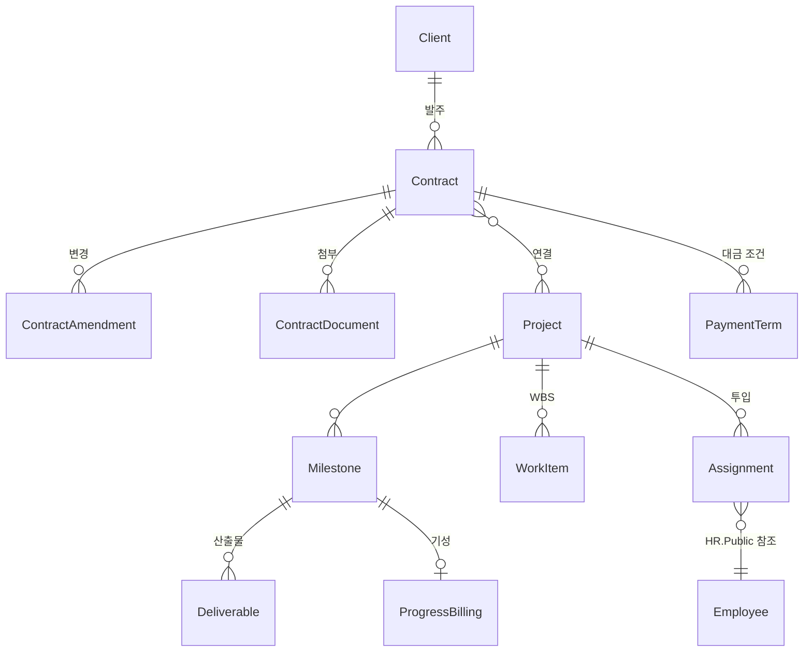

# 도메인: 프로젝트·계약 (Projects 모듈)

> 상태: 초안 · 갱신: 2026-10-21 · 용어: [glossary.md](../00-overview/glossary.md) · ERD: [projects](../06-data/erd/projects.md)

## 개념 모델

## 계약 (Contract)

| 속성 | 설명 |
|---|---|
| `ContractNumber` | 자동으로 매기는 번호. 예: `CT-2026-0012` |
| `Type` | `Outsourcing`(도급, SI 구축), `Service`(위임·용역, SM 운영), `Maintenance`(유지보수), `Staffing`(인력 공급) |
| `Tier` | `Prime`(원청), `Sub`(하도급). 하도급이면 원청사 정보를 함께 둡니다 |
| `Counterparty` | 매출 계약이면 고객사, 매입 계약(외주)이면 협력사 |
| `Direction` | `Sales`(매출), `Purchase`(매입) |
| 기간, 금액(공급가액, 부가세), 통화 | 금액은 `Confidential` 등급입니다 |
| `WarrantyMonths` | 하자보수 기간 |
| `Status` | `Draft` → `Signed` → `Active` → `Completed` → `Closed`. 해지되면 `Terminated` |

- **변경 계약**은 원래 계약을 고치지 않고 `ContractAmendment`로 쌓습니다. 현재 유효한 값은 원래 계약에 변경 계약들을 차례로 적용해서 계산합니다. 금액 변경 이력이 남아야 하기 때문입니다.
- 계약 문서(PDF)는 버전을 관리합니다. AI 추출 결과(AI-PRJ-01)는 문서 버전에 연결된 "제안"으로 저장합니다.
- 대금 조건(`PaymentTerm`)
  - SI: 선급금, 중도금(마일스톤 연계), 잔금(검수 후)
  - SM: 월정액

## 프로젝트 (Project)

| 속성 | 설명 |
|---|---|
| `ProjectCode` | 예: `PRJ-2026-0007`. 클라우드 비용 태그와 연결하는 키로도 씁니다 ([cloud-cost.md](cloud-cost.md)) |
| `Type` | `SI` 또는 `SM` |
| `OwningUnitId` | 담당 조직. 데이터 범위(`OwnUnit` 등)를 적용하는 기준입니다 ([authorization.md](../03-security/authorization.md)) |
| PM, 기간(계획과 실적), 예산(M/M과 금액) | |
| `Status` | `Proposal`(제안) → `Contracted` → `InProgress` → `Accepted`(검수 완료) → `Warranty`(하자보수) → `Closed`. 실패하면 `Dropped` |

- 계약 하나에 프로젝트가 여러 개일 수 있습니다(단계별 발주). 반대로 프로젝트 하나에 계약이 여러 개일 수도 있습니다(매출 계약 + 외주 매입 계약). 그래서 둘은 다대다 관계입니다.

## 일정 (Milestone, WorkItem)

- WBS는 트리 구조입니다(`ParentId`). 각 작업은 계획 기간, 실적 기간, 진척률, 담당자를 가집니다.
- 상위 작업의 진척률은 하위 작업의 계획 공수로 가중 평균해서 계산합니다.
- 마일스톤에 산출물을 연결하고, 검수가 완료되면 **기성 청구 대상**이 됩니다.

## 투입 (Assignment)과 M/M

| 속성 | 설명 |
|---|---|
| 직원 | HR 모듈의 `EmployeeId`. HR.Public으로 확인합니다 |
| 역할 | PM, PL, 개발, 디자인, QA 등 |
| 기간 | 시작일과 종료일 (`DateOnly`) |
| `AllocationRate` | 0.0~1.0 |
| `WorkLocation` | `Office`(사내), `OnSite`(고객사 상주), `Remote`(원격) |
| 단가 | 원가 계산에 쓰는 표준 단가. HR의 직원 단가가 기본값이고, 투입마다 바꿀 수 있습니다 |

### M/M 계산 규칙

- `M/M = Σ(해당 월의 근무일 중 투입된 일수 / 해당 월의 근무일 수) × 투입률`
- 근무일은 공휴일 달력(Platform 모듈)을 기준으로 계산합니다.
- 한 사람의 같은 날짜 투입률 합계가 **1.0을 넘으면 경고**합니다. 막지는 않습니다(현실에서 겸직이 있기 때문입니다).

## 도메인 규칙 요약

| 규칙 | 처리 |
|---|---|
| 계약 기간 밖의 투입 | 경고 |
| 외주 매입 계약이 없는 협력사 인력(`PartnerStaff`)의 투입 | 경고 |
| 검수가 완료되지 않은 마일스톤의 기성 청구 | 금지 |
| 퇴직자의 투입 (HR의 `EmployeeTerminated` 이벤트) | 투입 종료일을 퇴직일로 자동 조정하고 PM에게 알림 |

## 다른 모듈로 보내는 통합 이벤트

| 이벤트 | 받는 쪽 |
|---|---|
| `ProjectCreated`, `ProjectCodeChanged` | Accounting (클라우드 비용 배분 키) |
| `MilestoneAccepted` | Accounting (청구 예정·매출 전표 초안) |
| `AssignmentChanged` | Accounting (인건비 원가), HR (가동 현황) |

## SM 운영 (Phase 4)

SR(서비스 요청) 접수, 처리, SLA 측정(응답 시간, 해결 시간), 월간 운영 보고서를 다룹니다. 상세 설계는 나중에 합니다.
