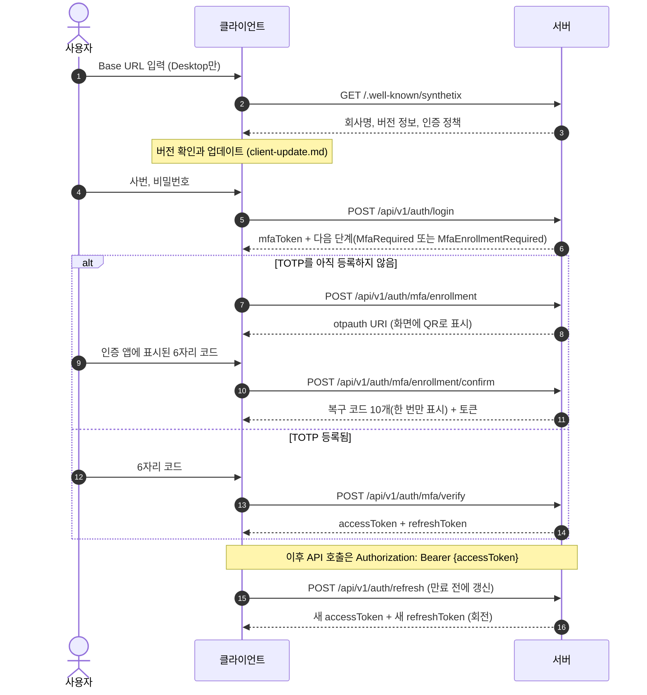

# 인증 (로그인 · MFA · JWT)

> 상태: 초안 · 갱신: 2026-10-21 · 관련: [ADR-0003](../adr/0003-authentication-mfa-jwt.md), [client-update.md](../01-architecture/client-update.md), [authorization.md](authorization.md)

## 전체 흐름



## 1단계: 서버 확인

`GET /.well-known/synthetix` (인증 불필요)

```json
{
  "product": "Synthetix",
  "organizationName": "㈜예시소프트",
  "serverVersion": "1.4.0",
  "apiVersions": ["v1"],
  "client": {
    "minVersion": "1.3.0",
    "latestVersion": "1.4.0",
    "updateFeedUrl": "https://erp.example.com/updates/win/",
    "allowDowngrade": false
  },
  "auth": {
    "mfaRequired": true,
    "passwordPolicy": { "minLength": 10 }
  }
}
```

- **Desktop**
  - 사용자가 Base URL을 입력합니다. 입력값은 정규화합니다(끝의 `/` 제거, 스킴이 없으면 `https://` 붙이기).
  - **HTTPS만 허용합니다.** `localhost`와 `127.0.0.1`은 개발용으로 HTTP를 허용합니다.
  - `product`가 `"Synthetix"`가 아니면 "Synthetix 서버가 아닙니다"라고 안내합니다.
  - 확인이 끝난 Base URL과 회사명은 저장해 두었다가 다음 실행 때 미리 채웁니다. 최근 서버 목록을 최대 5개까지 보관합니다.
- **Browser:** Base URL 입력 단계를 건너뛰고, 현재 페이지의 출처(origin)를 그대로 씁니다. (미결 사항 Q2)

## 2단계: 1차 인증 (사번 + 비밀번호)

`POST /api/v1/auth/login`

```json
{ "employeeNumber": "S2026001", "password": "********" }
```

성공하면 다음과 같이 응답합니다. 이 단계에서는 **JWT를 발급하지 않습니다.**

```json
{ "mfaToken": "q8f...", "nextStep": "MfaRequired", "expiresIn": 300 }
```

- `nextStep`은 `MfaRequired`, `MfaEnrollmentRequired`, `PasswordChangeRequired` 중 하나입니다. 비밀번호 변경이 필요하면 MFA를 마친 직후 변경 화면으로 보냅니다.
- `mfaToken`의 특징
  - 무작위 256비트 값입니다. 서버에는 SHA-256 해시만 저장합니다.
  - 유효 시간은 5분이고, **MFA 단계 API에서만** 쓸 수 있습니다.
  - 코드를 5번 틀리면 폐기되고, 처음부터 다시 로그인해야 합니다.
- 실패 응답은 **항상 같은 메시지**(`auth.invalid_credentials`)를 씁니다. 사번이 존재하는지, 비밀번호가 틀렸는지를 구분해 알려주지 않습니다. 응답 시간 차이도 줄입니다(없는 사번이어도 더미 해시를 검증).
- 계정 잠금: 연속 5번 실패하면 15분 동안 잠급니다. 잠긴 경우에도 같은 실패 메시지를 쓰고, 감사 로그에는 구분해서 기록합니다.
- 요청 제한: IP별로, 그리고 사번별로 제한합니다 (ASP.NET Core Rate Limiter).

## 3단계: MFA (TOTP)

| API | 요청 | 설명 |
|---|---|---|
| `POST /api/v1/auth/mfa/verify` | `{ mfaToken, code }` | 등록된 TOTP를 검증합니다 |
| `POST /api/v1/auth/mfa/enrollment` | `{ mfaToken }` | 비밀키를 만들고 `otpauth://` URI를 돌려줍니다 |
| `POST /api/v1/auth/mfa/enrollment/confirm` | `{ mfaToken, code }` | 첫 코드를 검증해 등록을 완료하고, 복구 코드를 발급합니다 |
| `POST /api/v1/auth/mfa/recovery` | `{ mfaToken, recoveryCode }` | 휴대폰을 잃어버렸을 때 사용합니다. 각 코드는 한 번만 쓸 수 있습니다 |

- TOTP 표준(RFC 6238): SHA-1, 6자리, 30초 주기. 시계 오차를 고려해 앞뒤 1주기까지 허용합니다.
- **같은 코드를 다시 쓸 수 없습니다.** 마지막으로 성공한 시간 구간(time step)을 저장하고, 그보다 같거나 이전인 구간의 코드는 거부합니다.
- TOTP 비밀키는 Data Protection으로 암호화해서 저장합니다. 복구 코드는 해시만 저장합니다.
- `otpauth://` URI의 형식: `otpauth://totp/Synthetix:{사번}?secret=...&issuer=Synthetix%20({회사명})`
- QR 코드는 **클라이언트가 직접 만듭니다**(QRCoder). 서버가 이미지를 만들어 보내지 않습니다.
- MFA 초기화(휴대폰 분실 + 복구 코드 분실)는 관리자만 할 수 있고, 감사 로그를 남깁니다.

## 토큰

### Access Token (JWT)

| 항목 | 값 |
|---|---|
| 서명 | ES256 (비대칭). 키 교체를 위해 헤더에 `kid`를 넣습니다 |
| 수명 | 15분 |
| `iss` / `aud` | 서버의 Base URL / `synthetix-api` |
| 클레임 | `sub`(UserAccount ID), `emp`(사번), `role`(역할 여러 개), `amr`(`["pwd","otp"]`), `sid`(세션 ID), `jti` |
| 넣지 않는 것 | 이름, 이메일, 부서 등 개인정보. JWT는 누구나 디코딩할 수 있기 때문입니다 |

- 세부 권한(permission)은 토큰에 넣지 않습니다. 서버가 역할을 보고 계산하고, 캐시에 둡니다 ([authorization.md](authorization.md)). 그래야 토큰이 커지지 않고, 권한이 바뀌면 바로 반영됩니다.
- 시계 오차는 30초까지 허용합니다.

### Refresh Token

| 항목 | 값 |
|---|---|
| 형식 | 무작위 256비트 값 (JWT가 아님). 서버에는 해시만 저장합니다 |
| 수명 | 세션 시작부터 최대 12시간 (미결 사항 Q10). 쓰지 않은 채로 2시간이 지나면 만료 |
| 회전 | 사용할 때마다 새 토큰을 발급하고, 이전 토큰은 사용 처리합니다 |
| 재사용 탐지 | 이미 사용한 토큰이 다시 들어오면 **같은 세션의 토큰을 모두 폐기**합니다. 토큰을 도난당한 경우로 보기 때문입니다 |

### 클라이언트별 전달과 저장

| | Desktop | Browser (WASM) |
|---|---|---|
| refresh 전달 | 응답 본문 | `HttpOnly; Secure; SameSite=Strict; Path=/api/v1/auth` 쿠키 |
| refresh 저장 | DPAPI(현재 사용자 범위)로 암호화한 파일 | 쿠키 (JavaScript가 읽을 수 없음) |
| access 저장 | 메모리 | 메모리 |
| 구분 방법 | 요청 헤더 `X-Synthetix-Client: desktop` | `X-Synthetix-Client: web` |

- 쿠키로 refresh를 요청할 때는 `X-Synthetix-Client` 헤더가 꼭 있어야 합니다. 다른 출처에서 이 헤더를 붙이려면 CORS 사전 요청을 통과해야 하므로, CSRF를 막는 효과가 있습니다. 서버는 CORS를 허용하지 않습니다(같은 출처만).
- 클라이언트는 `DelegatingHandler`로 다음을 처리합니다.
  - access 토큰을 붙여서 요청합니다.
  - 401을 받으면 refresh를 한 번 시도한 뒤 원래 요청을 다시 보냅니다.
  - 동시에 여러 요청이 401을 받아도 refresh는 하나만 진행합니다.

## 로그아웃과 세션 관리

- `POST /api/v1/auth/logout`: 현재 세션의 refresh 토큰을 모두 폐기합니다. access 토큰은 만료(최대 15분)될 때까지 유효합니다.
- 비밀번호 변경, MFA 초기화, 계정 비활성화가 일어나면 그 사용자의 모든 세션을 폐기합니다.
- 즉시 차단이 필요한 경우(예: 퇴직 처리)를 위해 **세션 ID(`sid`) 폐기 목록을 메모리 캐시에 두고** JWT 검증 단계에서 확인합니다.

## 비밀번호

- 해시: ASP.NET Core Identity `PasswordHasher` (PBKDF2)
- 정책: 최소 10자. 사번과 같거나 사번을 포함하면 안 됩니다. 흔히 쓰이는 비밀번호 목록에 있으면 거부합니다. 주기적인 강제 변경은 하지 않습니다(NIST SP 800-63B 권고).
- 초기 비밀번호와 관리자가 재설정한 비밀번호는 첫 로그인 때 반드시 바꿔야 합니다.

## 감사 이벤트

다음 이벤트를 `audit` 스키마에 기록합니다. 기록 항목은 IP, 클라이언트 종류, 클라이언트 버전입니다.

`LoginSucceeded`, `LoginFailed`(사유 포함), `AccountLocked`, `MfaEnrolled`, `MfaFailed`, `RecoveryCodeUsed`, `MfaReset`, `RefreshTokenReuseDetected`, `LoggedOut`, `PasswordChanged`

## 서버 키 관리

- JWT 서명 키(ES256)
  - 설치형: Windows 인증서 저장소 또는 Data Protection으로 보호한 파일에 둡니다.
  - Azure: Key Vault에 둡니다.
- 키를 교체할 때는 새 키로 서명을 시작하고, 이전 키는 검증용으로 access 토큰 수명 이상 남겨 둡니다.
