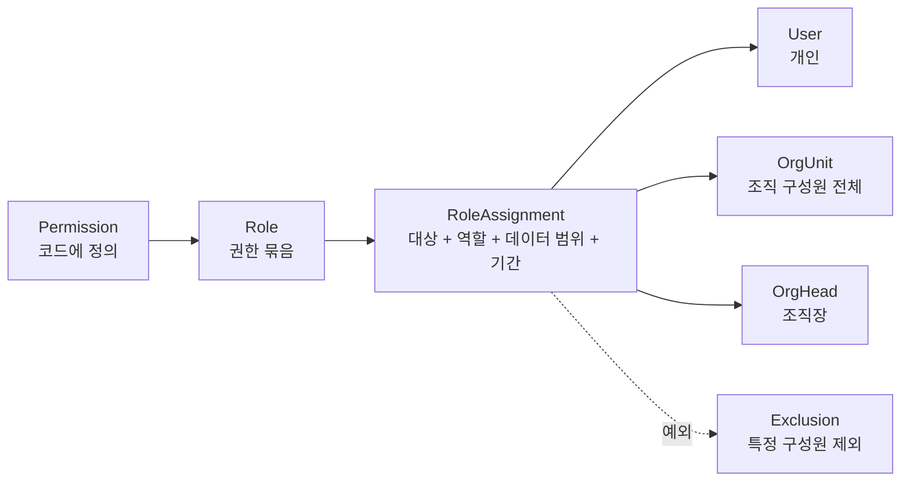

# 인가 (권한과 접근제어)

> 상태: 초안 · 갱신: 2026-10-21 · 관련: [authentication.md](authentication.md), [organization.md](../02-domain/organization.md), [data-protection.md](data-protection.md), [ADR-0007](../adr/0007-org-based-access-control.md)

권한은 세 겹으로 확인합니다.

1. **기능 권한:** 이 기능을 쓸 수 있는가? (Permission)
2. **데이터 범위:** 어느 범위의 데이터를 볼 수 있는가? (Data Scope)
3. **필드 권한:** 이 필드를 원문으로 볼 수 있는가?

역할은 **개인뿐 아니라 조직(부서, 팀)과 조직장에게도 부여**할 수 있습니다. 조직에 부여한 역할은 그 조직의 구성원에게 자동으로 적용됩니다.

## 구성 요소



### Permission (권한)

- 이름은 `{module}.{resource}.{action}` 형식입니다. 예: `projects.contracts.read`, `accounting.journals.approve`
- **권한은 코드에서만 정의합니다.** 상수는 `Synthetix.Contracts`의 `Permissions` 클래스에 두고, 서버가 시작할 때 DB의 권한 목록과 동기화합니다. 관리자는 권한을 새로 만들 수 없습니다. 역할에 권한을 묶는 것만 할 수 있습니다.
- 엔드포인트에는 `.RequirePermission(Permissions.Projects.Contracts.Read)`를 붙입니다.

### Role (역할)

- **시스템 역할:** 기본으로 제공하며 삭제할 수 없습니다. `SystemAdmin`, `Employee`
- **사용자 정의 역할:** 시스템 관리자가 만들고 권한을 묶습니다. 처음에는 아래 템플릿을 미리 넣어 둡니다.

| 역할 템플릿 | 주요 권한 |
|---|---|
| `SystemAdmin` | 조직·직원 기본 정보 관리, 역할·권한 관리, 시스템 설정, MFA 초기화. **업무 데이터와 민감정보 권한은 기본으로 포함하지 않습니다** |
| `Executive` | 모든 프로젝트와 손익 조회 |
| `ProjectManager` | 프로젝트의 계약·일정·투입 관리 |
| `ProjectMember` | 프로젝트 조회, 내 작업 갱신 |
| `HrManager` | 인사 전체, 조직 관리, 민감정보 열람(`hr.sensitive.read`) |
| `Accountant` | 전표 작성, 클라우드 비용 관리 |
| `AccountingManager` | 전표 승인, 회계 기간 마감 |
| `Employee` | 내 정보, 조직도 조회, 사내 문서 AI 질의. 모든 재직자에게 자동으로 부여됩니다 |

### RoleAssignment (역할 부여)

| 속성 | 설명 |
|---|---|
| `SubjectType` | `User`, `OrgUnit`, `OrgHead` |
| `SubjectId` | 사용자 ID, 또는 조직 ID |
| `IncludeDescendants` | `OrgUnit`과 `OrgHead`에서 하위 조직까지 포함할지 여부 |
| `RoleId` | |
| `DataScope` | 아래 "데이터 범위" 표 참고 |
| `ValidFrom`, `ValidTo` | 기간 한정 부여(예: 감사 대응 기간)에 씁니다. 기간이 지나면 자동으로 효력이 없어집니다 |
| `Reason`, `GrantedBy`, `GrantedAt` | 부여 사유는 필수입니다 |

| 대상 유형 | 의미 | 예 |
|---|---|---|
| `User` | 특정 구성원 한 명 | 홍길동에게 `Accountant` |
| `OrgUnit` | 조직 구성원 전체 (주 소속과 겸직 모두) | 인사팀 전원에게 `HrManager` |
| `OrgHead` | 조직의 조직장 | 기술본부 하위 모든 조직장에게 `ProjectManager` |

### Exclusion (예외)

- 조직이나 조직장을 통해 받은 역할에서 **특정 구성원만 빼고 싶을 때** 씁니다. 예: 인사팀 전원에게 `HrManager`를 주되, 인턴 한 명은 제외
- 일반적인 "거부(Deny)" 규칙은 두지 않습니다. 권한은 **허용을 합치는 방식**으로만 계산하고, 예외는 특정 부여 하나를 무력화하는 것으로 한정합니다. 그래야 "왜 이 권한이 있는가/없는가"를 항상 설명할 수 있습니다 (미결 사항 Q14).

## 데이터 범위 (Data Scope)

| 범위 | 의미 |
|---|---|
| `All` | 전체 |
| `OwnUnit` | **근거 조직**만 |
| `OwnUnitAndDescendants` | 근거 조직과 그 하위 조직 |
| `SpecifiedUnits` | 부여할 때 지정한 조직들 (하위 포함 여부 선택) |
| `AssignedProjects` | 내가 PM이거나 투입된 프로젝트 |
| `Self` | 나 자신 |

- **근거 조직**은 그 역할을 받게 된 소속 조직을 말합니다. `User` 대상으로 부여했다면 주 소속 조직입니다.
  - 예: 겸직으로 B팀에 소속돼 B팀 부여 역할을 받았다면, `OwnUnit`은 B팀입니다.
- 업무 데이터는 **소유 조직**을 가집니다. 범위는 이 값을 기준으로 적용합니다.
  - 직원: 주 소속 조직
  - 프로젝트: 담당 조직(`OwningUnitId`)
  - 전표 줄: 코스트센터
- 핸들러는 `IDataScopeProvider`에게 "이 권한에 대해 허용된 조직 ID 집합(또는 전체)"을 받아, 쿼리 조건으로 **명시적으로** 적용합니다. EF 전역 필터에 숨기지 않습니다.
- 범위 밖의 리소스에 접근하면 403이 아니라 **404**를 돌려줍니다. 데이터가 있는지조차 알려주지 않기 위해서입니다.

## 유효 권한 계산

```
1. 내 소속 조직 U = 유효한 주 소속 + 겸직
2. 부여 수집
   - User = 나
   - OrgUnit ∈ U
   - OrgUnit ∈ U의 상위 조직 중 IncludeDescendants = true
   - OrgHead: 내가 조직장인 조직이 대상에 해당
3. 기간이 지났거나, 나를 제외(Exclusion)한 부여는 버림
4. 권한별로 데이터 범위를 합침 (All이 있으면 All, 그 외에는 조직 집합의 합집합)
```

**예:** 김개발은 플랫폼팀 팀장이고, 플랫폼팀은 기술본부 소속입니다.

| 출처 | 역할 | 범위 |
|---|---|---|
| 기술본부에 부여 (하위 포함) | `ProjectMember` | `AssignedProjects` |
| 기술본부 하위 조직장에게 부여 | `ProjectManager` | `OwnUnitAndDescendants` → 플랫폼팀 |
| 전 직원 (시스템) | `Employee` | `Self` |

### 권한 설명과 시뮬레이션

| API | 용도 |
|---|---|
| `GET /api/v1/identity/users/{id}/effective-permissions` | 유효 권한과 **각 권한의 출처 경로**. 예: "플랫폼팀 조직장 → 기술본부 하위 조직장 부여 → ProjectManager" |
| `POST /api/v1/identity/access-simulations` | 조직개편안이나 역할 변경안을 넣으면, 적용하기 전에 **권한이 바뀌는 사용자와 그 차이**를 돌려줍니다 |

관리 화면에서는 조직도의 "권한 보기 모드"로 이 내용을 시각화합니다 ([organization.md](../02-domain/organization.md)).

## 모듈 사이의 구현 구조

- 조직 구조의 원본은 HR 모듈에 있습니다. 역할 부여와 권한 계산은 Identity 모듈이 합니다.
- Identity는 HR의 통합 이벤트를 받아 **조직 프로젝션**(`iam.OrgUnits`, `iam.OrgMemberships`: ID, 부모, `hierarchyid`, 소속, 조직장 여부)을 따로 유지합니다. 권한을 확인할 때마다 HR을 동기 호출하지 않기 위해서입니다.
- 유효 권한은 사용자별로 메모리에 캐시합니다. 다음 이벤트가 오면 캐시를 무효화합니다: 조직 변경, 소속 변경, 역할 부여 변경, 역할의 권한 구성 변경
- 권한은 JWT에 넣지 않으므로, 바뀐 권한은 이벤트가 전달되는 즉시(수 초 안에) 반영됩니다.
- 퇴직 처리처럼 바로 막아야 하는 경우에는 세션 폐기를 함께 합니다 ([authentication.md](authentication.md)).

## 관리 권한과 안전장치

| 규칙 | 내용 |
|---|---|
| 초기 세팅 | 첫 시스템 관리자는 서버 명령(`create-admin`)으로만 만듭니다. 이후 설정은 초기 설정 마법사에서 합니다 ([organization.md](../02-domain/organization.md)) |
| 마지막 관리자 보호 | 활성 `SystemAdmin`이 한 명뿐이면 그 사람의 역할을 회수하거나 계정을 비활성화할 수 없습니다 |
| 자기 권한 상승 제한 | 관리자가 두 명 이상이면, 자기 자신에게 역할을 부여할 수 없습니다 |
| 특권 역할 변경 | `SystemAdmin`이나 `hr.sensitive.read`를 포함한 역할을 부여하거나 바꾸면, 모든 시스템 관리자에게 알리고 감사 로그를 남깁니다 |
| 관리 권한 위임 (Phase 2 이후) | `identity.assignments.manage`를 `OwnUnitAndDescendants` 범위로 부여하면 부서 관리자가 됩니다. 부서 관리자는 **위임 가능(`Delegable`)으로 표시된 역할만**, 자기 범위 안에서만 부여할 수 있습니다 (미결 사항 Q15) |
| 감사 | 역할, 부여, 예외, 권한 구성의 모든 변경을 사유와 함께 기록합니다 |

## 필드 권한 (민감정보)

- `Restricted` 등급 필드(주민번호, 계좌번호 등)는 응답 DTO에 기본적으로 **가린 값**으로 들어갑니다. 예: `900101-1******`
- 원문은 별도 API(`GET .../sensitive`)로만 조회할 수 있습니다. 필요한 권한(예: `hr.sensitive.read`)과 열람 사유가 있어야 하고, **조회할 때마다 감사 로그를 남깁니다.**
- 분류 기준은 [data-protection.md](data-protection.md)를 따릅니다.

## 클라이언트

- 로그인한 뒤 `GET /api/v1/me`로 내 권한 목록(권한 이름만, 범위 제외)을 받아 메뉴와 버튼 표시에 씁니다.
- **UI에서 숨기는 것은 편의 기능일 뿐이고, 실제 검사는 항상 서버가 합니다.**

## AI와 권한

- AI 기능은 **요청한 사용자의 권한과 데이터 범위로만** 데이터에 접근합니다. AI 전용 서비스 계정이나 권한 상승은 없습니다 ([ai-gateway.md](../04-ai/ai-gateway.md)).
