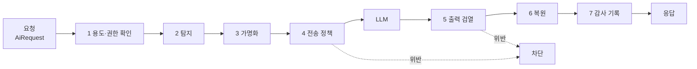

# AI Gateway

> 상태: 초안 · 갱신: 2026-10-21 · 관련: [ADR-0005](../adr/0005-ai-gateway-local-llm.md), [deidentification.md](deidentification.md), [use-cases.md](use-cases.md)

## 원칙

1. **출구는 하나입니다.** 모든 LLM 호출은 `Synthetix.Modules.AI`의 `IAiGateway`를 거칩니다. 다른 모듈은 LLM SDK를 참조하지 않으며, 이것을 아키텍처 테스트로 확인합니다.
2. **처음부터 안전하게 동작합니다.** 외부 LLM 전송은 기본적으로 차단합니다. 비식별화 단계에서 오류가 나면 **요청을 막습니다**(실패해도 데이터가 새지 않는 쪽으로).
3. **AI가 제안하고 사람이 승인합니다.** 데이터를 바꾸는 작업은 AI가 직접 하지 않습니다. 항상 "제안 → 사용자 확인 → 저장" 순서를 거칩니다.
4. **사용자의 권한을 넘지 않습니다.** AI는 요청한 사용자의 권한과 데이터 범위 안에서만 데이터를 읽습니다.
5. **모든 호출을 추적할 수 있습니다.** 모든 호출을 감사 로그에 남깁니다. 저장하는 내용은 가명화된 상태입니다.

## 처리 파이프라인



| 단계 | 내용 |
|---|---|
| 1. 용도·권한 확인 | 등록된 `AiPurpose`인지, 사용자에게 그 용도에 필요한 권한이 있는지 확인합니다 |
| 2. 탐지 | 구조화 데이터의 분류 정보, 정규식, 사전으로 민감정보를 찾습니다 ([deidentification.md](deidentification.md)) |
| 3. 가명화 | `[PERSON_1]` 같은 토큰으로 바꿉니다. 바꾼 내용(매핑)은 요청 범위의 메모리에만 둡니다 |
| 4. 전송 정책 | 데이터 등급과 모델의 신뢰 수준을 비교해서 허용, 추가 가명화, 차단 중 하나로 결정합니다 (아래 표) |
| 5. 출력 검열 | 민감정보가 다시 노출됐는지, 금칙어가 있는지, 스키마 위반인지, 프롬프트 인젝션의 흔적이 있는지 검사합니다 |
| 6. 복원 | 토큰을 원래 값으로 되돌립니다. 단, 사용자가 볼 권한이 있는 값만 되돌립니다 |
| 7. 감사 기록 | `ai.Interactions` 테이블에 저장합니다 |

## 사용 방법 (모듈 쪽)

```csharp
var result = await aiGateway.ExtractAsync<ContractExtraction>(new AiRequest
{
    Purpose = AiPurposes.ContractExtraction,     // 등록된 용도 ID
    Input = AiInput.FromDocument(documentText),
    StructuredContext = new { contract.Title },  // 분류 메타데이터가 있는 객체는 자동으로 처리
}, ct);
// result.Value는 사람이 확인하기 전의 "제안"입니다. 바로 저장하지 않습니다.
```

| 메서드 | 용도 |
|---|---|
| `CompleteAsync` | 텍스트 생성 (요약, 초안 작성) |
| `ExtractAsync<T>` | JSON 스키마에 맞춘 구조화 추출. 결과는 `Contracts`의 검증기로 확인합니다 |
| `StreamAsync` | 채팅 스트리밍. 클라이언트에는 SSE로 전달합니다 |
| `EmbedAsync` | 임베딩 생성 (RAG) |

## 용도(Purpose) 등록

각 AI 기능은 **용도 정의**로 등록합니다. 용도 정의는 코드로 관리하며, 운영 중에 바꿀 수 있는 값은 설정 파일로 뺍니다.

```yaml
id: AI-PRJ-01
name: 계약서 정보 추출
requiredPermission: projects.contracts.write
maxDataClassification: Confidential   # 이 용도에서 다룰 수 있는 가장 높은 등급
model: local-default                  # 모델 별칭
promptTemplate: prompts/contract-extraction.v1
outputSchema: ContractExtraction
```

## 모델 공급자와 전송 정책

| 공급자 | 신뢰 수준 | 예 |
|---|---|---|
| 로컬 | `OnPremises` | 사내 Ollama, vLLM |
| 기업 전용 클라우드 | `PrivateCloud` | Azure OpenAI (데이터를 학습에 쓰지 않는다는 계약이 있는 경우) |
| 공용 API | `PublicCloud` | 기본적으로 쓰지 않음 |

| 데이터 등급 | OnPremises | PrivateCloud | PublicCloud |
|---|---|---|---|
| Public / Internal | 원문 | 원문 | 가명화 |
| Confidential | 원문 또는 가명화 (용도에 따라) | 가명화 | 차단 |
| Restricted | **차단** (탐지되면 제외) | 차단 | 차단 |

- 로컬 LLM이라도 `Restricted` 데이터는 보내지 않습니다. 로컬 모델 서버의 로그나 캐시도 유출 경로가 될 수 있기 때문입니다.
- 외부 공급자는 관리자가 명시적으로 켜야 합니다. 켜고 끈 이력은 감사 로그에 남습니다.

## 로컬 LLM

- Ollama의 OpenAI 호환 엔드포인트(`/v1`)를 쓰고, `Microsoft.Extensions.AI`의 `IChatClient`로 추상화합니다.
- 모델 별칭(예: `local-default`, `local-embedding`)을 설정 파일에서 실제 모델에 연결합니다.
  - 후보: 한국어 성능이 좋은 공개 모델(EXAONE, Qwen 계열 등)
  - 최종 결정은 하드웨어를 확인한 뒤 합니다 (미결 사항 Q4)
- 시간 제한, 재시도, 동시 요청 수 제한을 둡니다. LLM 서버가 멈춰도 ERP의 핵심 기능은 계속 동작해야 합니다. AI 기능만 "일시적으로 사용할 수 없음"으로 바뀝니다.

## 프롬프트 인젝션 대응

- 시스템 지시와 데이터를 분리합니다. 문서, 검색 결과, 사용자 입력은 구분자로 감싸서 "데이터"라고 명시합니다.
- LLM이 쓸 수 있는 도구(tool)는 **읽기 전용**입니다. 도구는 사용자 권한으로 실행됩니다. 쓰기는 제안을 만드는 것까지만 할 수 있습니다.
- 출력은 가능하면 구조화 스키마로 받고, 검증을 통과하지 못하면 버립니다.
- 프롬프트 템플릿은 버전을 붙여 저장소(`prompts/`)에서 관리합니다. 감사 로그에는 템플릿 버전이 기록됩니다.

## 감사 기록 (`ai.Interactions`)

| 필드 | 내용 |
|---|---|
| 용도, 사용자, 시각, 모델, 공급자 | |
| 프롬프트 템플릿 버전 | |
| 가명화된 입력과 출력 | 원문은 저장하지 않습니다 |
| 탐지된 민감정보의 유형별 개수 | 예: PERSON 3, PHONE 1 |
| 정책 결정 | 허용, 가명화, 차단과 그 이유 |
| 토큰 수, 지연 시간 | |
| 사용자 피드백 | 제안을 채택했는지, 수정했는지, 거절했는지. 품질 개선에 씁니다 |

## 평가 (Evals)

- 용도마다 정답 데이터셋을 `tests/Synthetix.AI.Evals/`에 둡니다. 데이터셋은 **가상 데이터로만** 만듭니다.
- 모델이나 프롬프트를 바꾸면 평가를 다시 돌려 이전 결과와 비교합니다. 예: 추출 정확도, 비식별화 재현율
