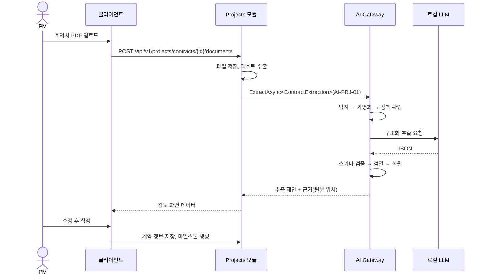

# AI 활용 시나리오

> 상태: 초안 · 갱신: 2026-10-21 · 관련: [ai-gateway.md](ai-gateway.md)

## 설계 원칙

- **규칙으로 풀 수 있는 문제에는 LLM을 쓰지 않습니다.** 계약 만료일 계산이나 M/M 합계는 코드로 처리합니다. LLM은 비정형 텍스트를 이해하거나, 설명과 초안을 쓰는 데만 씁니다.
- 결과는 항상 **제안**입니다. 화면에서 AI가 만든 값과 사람이 입력한 값을 구분해서 보여주고, 근거(원문 위치, 계산 기준)를 함께 표시합니다.
- 각 시나리오의 ID는 `AiPurpose`로 그대로 씁니다.

## 시나리오 목록

| ID | 이름 | 입력 | 출력 | 사람의 확인 | 최대 등급 | Phase |
|---|---|---|---|---|---|---|
| AI-PRJ-01 | 계약서 정보 추출 | 계약서 PDF의 텍스트 | 계약 당사자, 기간, 금액, 지급 조건, 마일스톤, 하자보수 기간, 지체상금 조항 | 추출 결과 검토 화면에서 수정한 뒤 저장 | Confidential | 1 |
| AI-PRJ-02 | 일정 위험 감지 | WBS 진척, 계획 대비 실적, 투입 현황 | 위험한 작업과 그 이유, 대응 제안 | PM이 확인 | Internal | 1 |
| AI-PRJ-03 | 주간 보고 초안 | 지난주 작업 변경 이력, 이슈 | 주간 보고서 초안 | PM이 편집한 뒤 확정 | Internal | 1 |
| AI-HR-01 | 계약 만료 대응 안내 | 만료 예정 목록 (규칙 엔진이 계산) | 대응 방안 요약, 통지문 초안 | 인사 담당자가 확인 | Confidential | 2 |
| AI-HR-02 | 프로젝트 인력 추천 | 프로젝트 요구 기술과 기간, 후보의 기술·투입 가능 여부 | 후보 순위와 추천 이유 | PM과 인사 담당자가 결정 | Confidential | 2 |
| AI-HR-03 | 경력기술서 파싱 | 협력사 인력의 경력기술서 (문서) | 기술, 경력 프로젝트, 기간 | 검토 후 저장 | Confidential | 2 |
| AI-ACC-01 | 클라우드 비용 이상 설명 | 이상치 탐지 결과(통계 기반), 서비스별 변동 | 원인 추정과 설명, 조치 제안 | 담당자가 확인 | Confidential | 3 |
| AI-ACC-02 | 계정과목 추천 | 거래 내용 (적요, 거래처, 금액) | 계정과목 후보와 신뢰도 | 전표 작성자가 선택 | Confidential | 3 |
| AI-ACC-03 | 프로젝트 손익 요약 | 프로젝트 손익 데이터 | 경영진용 요약 | 참고용 | Confidential | 3 |
| AI-CMN-01 | 사내 문서 Q&A (RAG) | 질문, 권한 범위 안의 문서 조각 | 답변과 출처 | 참고용 | Internal | 4 |
| AI-CMN-02 | 자연어 조회 | 질문 ("이번 달 투입률이 낮은 사람은?") | 미리 정의된 조회 함수 호출 → 표 | 참고용 | Confidential | 4 |

## 대표 시나리오 상세: AI-PRJ-01 계약서 정보 추출

- 추출한 각 필드에는 **원문 근거**(페이지와 문장)를 붙입니다. 검토 화면에서는 원문과 추출 값을 나란히 보여줍니다.
- 신뢰도가 낮거나 근거를 찾지 못한 필드는 강조해서 표시합니다.
- 사용자가 고친 내용은 감사 로그의 피드백으로 저장하고, 평가셋을 개선하는 데 씁니다.

## AI-CMN-02 자연어 조회의 안전장치

- LLM이 SQL을 직접 만들게 하지 않습니다. **미리 정의한 조회 함수**(tool) 중에서 고르고 매개변수만 채우게 합니다.
- 조회 함수는 일반 API와 같은 권한 검사와 데이터 범위를 적용합니다.
