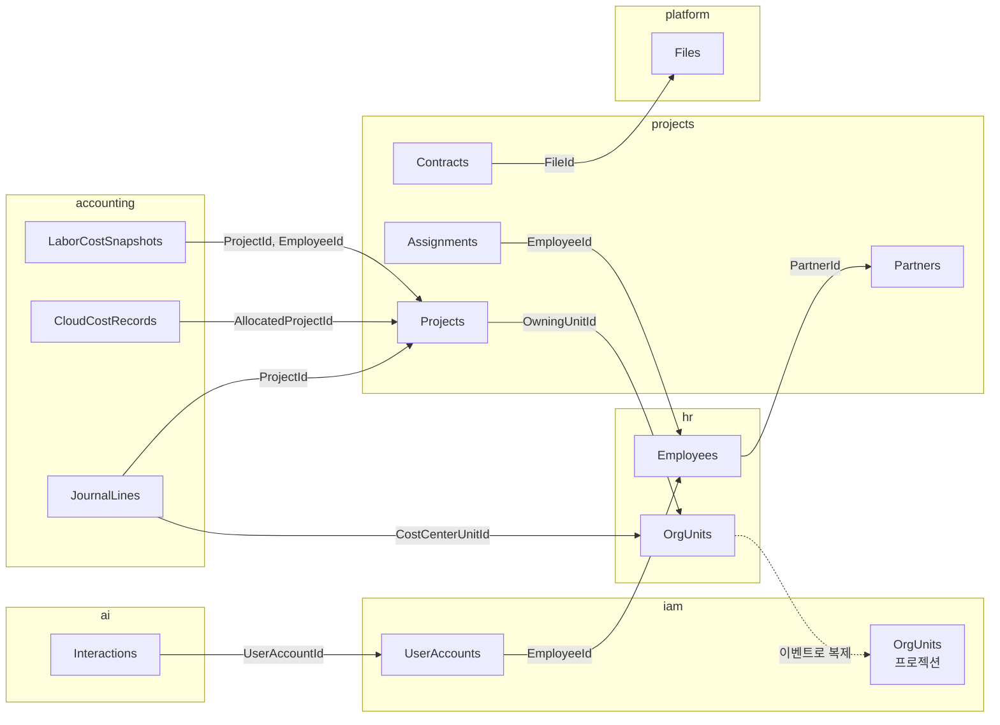

# ERD (논리 데이터 모델)

> 상태: 초안 · 갱신: 2026-10-21 · 관련: [db-conventions.md](../db-conventions.md) · 실행 가능한 SQL: [ddl/](../ddl/README.md)

모듈마다 스키마 하나, 문서 하나로 나눕니다. 업무의 의미와 규칙은 [02-domain](../../02-domain/) 문서에 있고, 이 폴더에는 **테이블, 주요 컬럼, 키, 제약조건**만 둡니다.

| 문서 | 스키마 | 내용 |
|---|---|---|
| [identity.md](identity.md) | `iam` | 계정, MFA, 세션, 역할과 역할 부여, 조직 프로젝션 |
| [hr.md](hr.md) | `hr` | 조직, 소속, 조직개편, 직원, 근로 계약, 파견, 기술, 단가, 만료 알림 |
| [projects.md](projects.md) | `projects` | 거래처, 계약, 계약 문서와 AI 추출, 프로젝트, 일정, 투입, 기성 |
| [accounting.md](accounting.md) | `accounting` | 계정과목, 전표, 세금계산서, 청구 일정, 환율, 인건비, 클라우드 비용 |
| [platform.md](platform.md) | `platform`, `audit`, `ai`, `outbox` | 파일, 공통 코드, 알림, 감사 로그, AI 기록, 통합 이벤트 |

## 표기 규칙

- Mermaid `erDiagram`을 씁니다. 컬럼 표기는 `타입 이름 키 "설명"` 형식입니다.
  - 타입의 길이와 정밀도는 설명에 적습니다. 예: `nvarchar Name "100"`
- **공통 컬럼은 다이어그램에서 생략합니다:** `CreatedAt`, `CreatedBy`, `UpdatedAt`, `UpdatedBy`, `RowVersion` ([db-conventions.md](../db-conventions.md))
- 다른 모듈을 가리키는 컬럼은 **외래키 없이 값으로만 참조**합니다. 설명에 `→ schema.Table`로 표시합니다.
- 다이어그램 아래 표에는 유니크 인덱스, 필터 인덱스, 검사 제약조건, 임시 테이블 여부를 적습니다.

## 모듈 사이의 값 참조

- **거래처의 원본은 `projects`입니다.** 고객사(`Clients`)와 협력사(`Partners`) 모두 해당합니다. 계약 상대방이기 때문입니다. HR은 협력사 인력의 소속 회사를 `PartnerId` 값으로 참조합니다.
- 값으로만 참조하므로 참조 무결성은 애플리케이션이 지킵니다.
  - 저장할 때 상대 모듈의 `.Public` API로 존재 여부를 확인합니다.
  - 상대가 삭제되거나 폐지되면 통합 이벤트로 반응합니다.

## 문서와 실제 모델의 동기화

- **설계 단계(지금):** 이 문서들과 [DDL](../ddl/README.md)이 기준입니다. 둘이 어긋나지 않는지 `tools/ddl/Test-Ddl.ps1`이 컬럼 단위로 대조합니다.
- **구현 이후:** 원본은 EF Core 모델입니다.
  - `tools/ErdGenerator`가 각 DbContext의 `IModel`을 읽어 `erd/generated/{schema}.md`를 만듭니다.
  - CI에서는 생성 결과가 커밋된 파일과 다르면 실패합니다(드리프트 검사).
  - 손으로 쓴 이 문서들은 업무 설명과 다이어그램 중심으로 줄이고, 컬럼 목록은 생성된 문서로 대체합니다.
