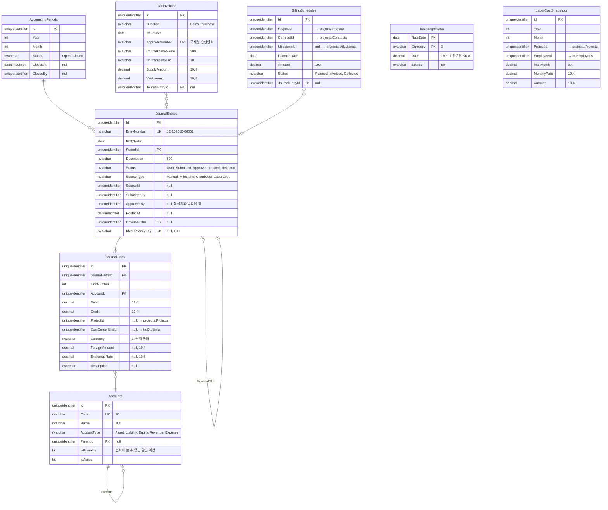
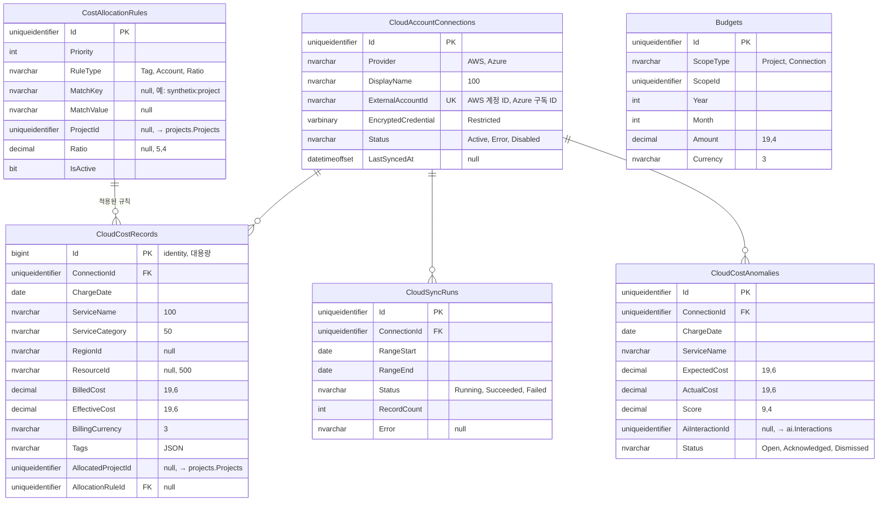

# ERD: accounting

> 상태: 초안 · 갱신: 2026-10-21 · 업무 규칙: [accounting.md](../../02-domain/accounting.md), [cloud-cost.md](../../02-domain/cloud-cost.md) · DDL: [04-accounting.sql](../ddl/04-accounting.sql)

## 회계

## 클라우드 비용

## 제약조건과 인덱스

| 테이블 | 내용 |
|---|---|
| `AccountingPeriods` | `UX(Year, Month)` |
| `CloudAccountConnections` | `UX(Provider, ExternalAccountId)` |
| `JournalEntries` | `UX(EntryNumber)`, `UX(IdempotencyKey) WHERE IdempotencyKey IS NOT NULL` |
| `JournalLines` | CHECK: `Debit >= 0 AND Credit >= 0 AND (Debit = 0 OR Credit = 0) AND Debit + Credit > 0`. 컬럼 이름이 `LineNo`가 아닌 `LineNumber`인 이유: `LINENO`는 T-SQL 예약어입니다. 차변 합계 = 대변 합계 검사는 도메인에서 합니다 |
| `JournalLines` | `IX(ProjectId)`, `IX(CostCenterUnitId)`: 손익 집계와 데이터 범위 |
| `LaborCostSnapshots` | `UX(Year, Month, ProjectId, EmployeeId)` |
| `CloudCostRecords` | 다시 수집할 때는 `(ConnectionId, ChargeDate)` 범위를 지우고 다시 넣습니다. 분석 쿼리용 **클러스터형 columnstore 인덱스**를 검토합니다 |
| `CostAllocationRules` | `IX(Priority) WHERE IsActive = 1` |
| `Budgets` | `UX(ScopeType, ScopeId, Year, Month)` |
| 임시 테이블 | `Accounts`, `CostAllocationRules` |

## 메모

- `Posted` 상태의 전표와 줄은 수정과 삭제를 막습니다. 애플리케이션에서 검사하고, DB 트리거로 한 번 더 막는 방안을 검토합니다.
- `CloudCostRecords`는 GUID 대신 `bigint identity`를 씁니다. 대용량으로 추가만 하는 테이블이기 때문입니다 ([db-conventions.md](../db-conventions.md)의 키 규칙 예외).
