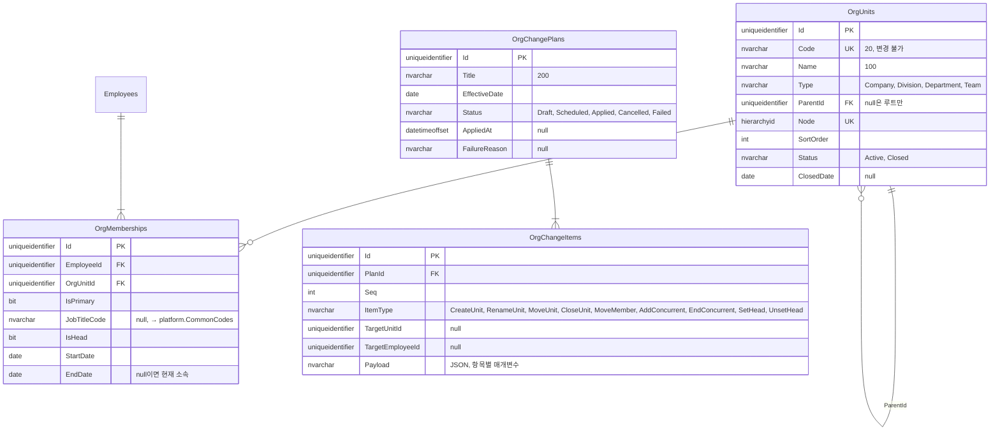
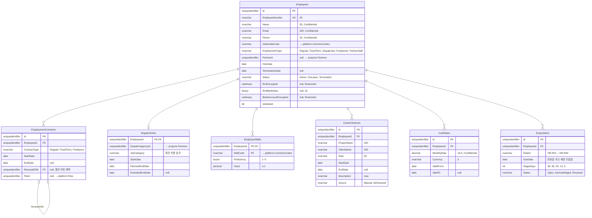

# ERD: hr

> 상태: 초안 · 갱신: 2026-10-21 · 업무 규칙: [organization.md](../../02-domain/organization.md), [hr.md](../../02-domain/hr.md) · DDL: [02-hr.sql](../ddl/02-hr.sql)

## 조직

## 직원

## 제약조건과 인덱스

| 테이블 | 내용 |
|---|---|
| `OrgUnits` | `UX(Code)`, `UX(Node)`, `UX(ParentId) WHERE ParentId IS NULL` (루트는 하나뿐) |
| `OrgMemberships` | `UX(EmployeeId) WHERE IsPrimary = 1 AND EndDate IS NULL` (현재 주 소속은 하나) |
| `OrgMemberships` | `UX(OrgUnitId) WHERE IsHead = 1 AND EndDate IS NULL` (현재 조직장은 한 명) |
| `OrgMemberships` | CHECK: `EndDate IS NULL OR EndDate >= StartDate` |
| `Employees` | `UX(EmployeeNumber)`, `IX(RrnBlindIndex)` |
| `CostRates` | 같은 직원의 기간이 겹치면 안 됩니다. 이 검사는 애플리케이션이 합니다 |
| `ExpiryAlerts` | `UX(EmployeeId, RuleId, DueDate, StageDays)`: 매일 실행해도 중복으로 만들어지지 않게 |
| 임시 테이블 | `OrgUnits`, `OrgMemberships`, `Employees`, `CostRates`, `EmploymentContracts` |

## 메모

- 순환 구조 금지와 계층 순서는 `hierarchyid`만으로 보장되지 않습니다. 도메인 규칙으로 검사합니다 ([organization.md](../../02-domain/organization.md)).
- 조직을 이동하면 하위 조직 전체의 `Node`를 다시 계산합니다(`GetReparentedValue`). 이 작업은 개편 적용 트랜잭션 안에서 합니다.
