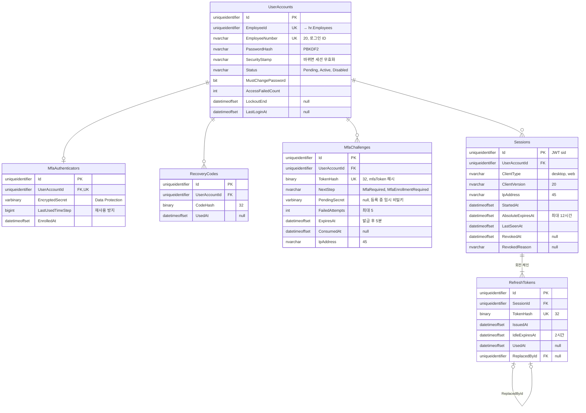
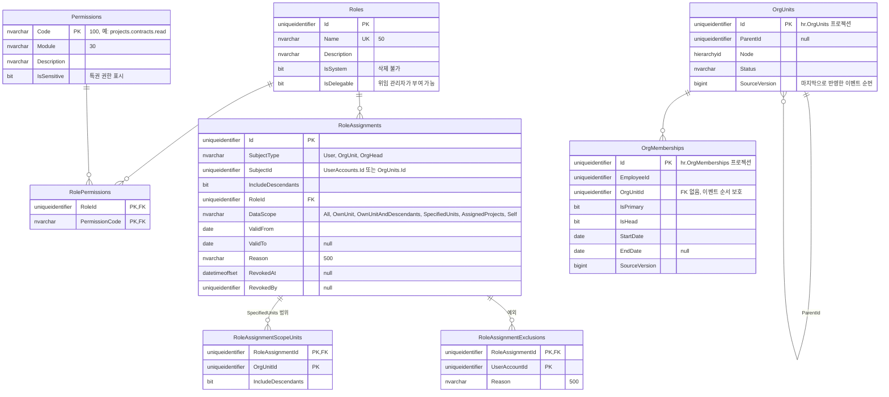

# ERD: iam (Identity 모듈)

> 상태: 초안 · 갱신: 2026-10-21 · 업무 규칙: [authentication.md](../../03-security/authentication.md), [authorization.md](../../03-security/authorization.md) · DDL: [01-iam.sql](../ddl/01-iam.sql)

## 계정, MFA, 세션

## 역할과 권한

## 제약조건과 인덱스

| 테이블 | 내용 |
|---|---|
| `UserAccounts` | `UX(EmployeeNumber)`, `UX(EmployeeId)` |
| `MfaChallenges`, `RefreshTokens` | `UX(TokenHash)`. 만료된 행은 정리 작업이 매일 지웁니다 |
| `Sessions` | `IX(UserAccountId) WHERE RevokedAt IS NULL`: 활성 세션 조회와 일괄 폐기 |
| `RoleAssignments` | `IX(SubjectType, SubjectId) WHERE RevokedAt IS NULL`. `SubjectId`는 대상 유형에 따라 가리키는 테이블이 달라서 FK가 없습니다. 애플리케이션이 검증합니다 |
| `RoleAssignments` | CHECK: `SubjectType = 'User'`이면 `IncludeDescendants = 0` |
| `OrgUnits` (프로젝션) | `IX(Node)`: 상위·하위 조직 조회 |
| `OrgUnits`, `OrgMemberships` (프로젝션) | 이벤트 도착 순서가 어긋날 수 있어 FK를 걸지 않습니다. `SourceVersion`보다 오래된 이벤트는 무시합니다 |
| 임시 테이블 | `Roles`, `RolePermissions`, `RoleAssignments`, `RoleAssignmentScopeUnits`, `RoleAssignmentExclusions`: 과거 시점의 권한 상태 조회와 감사에 씁니다 |

## 메모

- ASP.NET Core Identity Core를 쓰면 기본 테이블(`AspNetUsers` 등)을 위 이름과 컬럼에 맞게 매핑합니다. Identity가 필요로 하는 컬럼(`NormalizedUserName`, `ConcurrencyStamp` 등)은 구현할 때 추가합니다 (미결 사항 Q11).
- 활성 사용자의 `EmployeeId`로 프로젝션 `OrgMemberships`를 조인해서 소속 조직을 구합니다.
