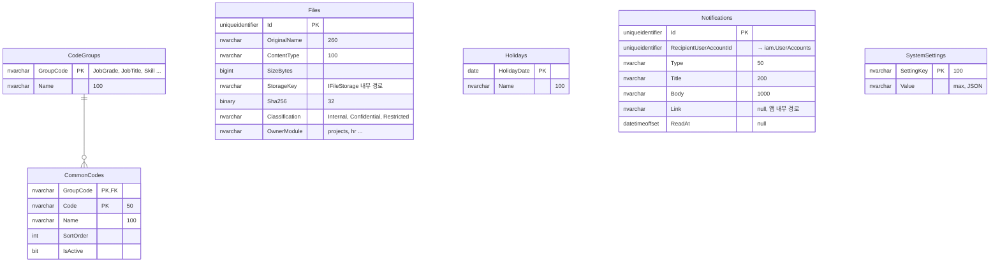
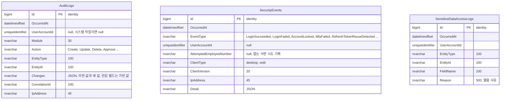
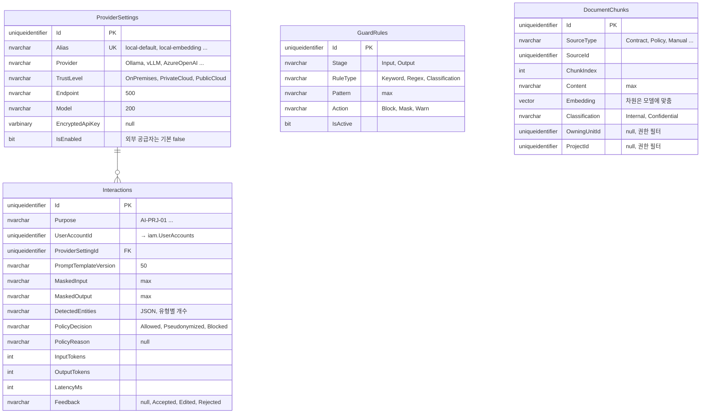
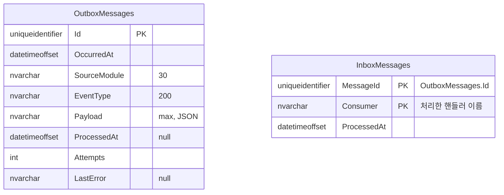

# ERD: platform, audit, ai, outbox

> 상태: 초안 · 갱신: 2026-10-21 · 관련: [system-overview.md](../../01-architecture/system-overview.md), [data-protection.md](../../03-security/data-protection.md), [ai-gateway.md](../../04-ai/ai-gateway.md) · DDL: [05-platform.sql](../ddl/05-platform.sql)

## platform

## audit (추가만 가능)

## ai

## outbox (모듈 사이 통합 이벤트)

## 제약조건과 인덱스

| 테이블 | 내용 |
|---|---|
| `Notifications` | `IX(RecipientUserAccountId) WHERE ReadAt IS NULL` |
| `audit.*` | 애플리케이션 DB 계정에는 `INSERT`와 `SELECT`만 허용합니다(`UPDATE`, `DELETE` 거부). 보존 기간이 지난 데이터는 별도 계정으로 실행하는 정리 작업이 지웁니다 |
| `AuditLogs` | `IX(EntityType, EntityId)`, `IX(OccurredAt)` |
| `Interactions` | `IX(Purpose, CreatedAt)`, `IX(UserAccountId, CreatedAt)` |
| `DocumentChunks` | `UX(SourceType, SourceId, ChunkIndex)`. 벡터 인덱스는 SQL Server 2025의 벡터 인덱스 지원 범위를 확인한 뒤 정합니다 |
| `OutboxMessages` | `IX(OccurredAt) WHERE ProcessedAt IS NULL` |
| `InboxMessages` | PK `(MessageId, Consumer)`: 같은 이벤트를 다시 받아도 한 번만 처리합니다(멱등성) |

## 메모

- `DocumentChunks.Content`에 원문을 저장할지, 가명화한 텍스트를 저장할지는 RAG를 설계할 때(Phase 4) 정합니다. 어느 경우든 검색 결과는 요청한 사용자의 데이터 범위로 거릅니다.
- `Interactions`에는 원문을 저장하지 않습니다 ([ai-gateway.md](../../04-ai/ai-gateway.md)).
