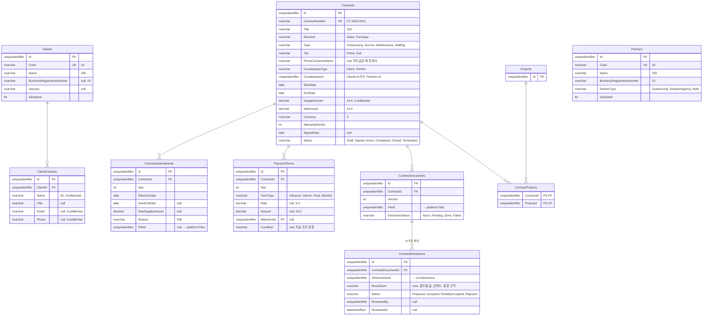
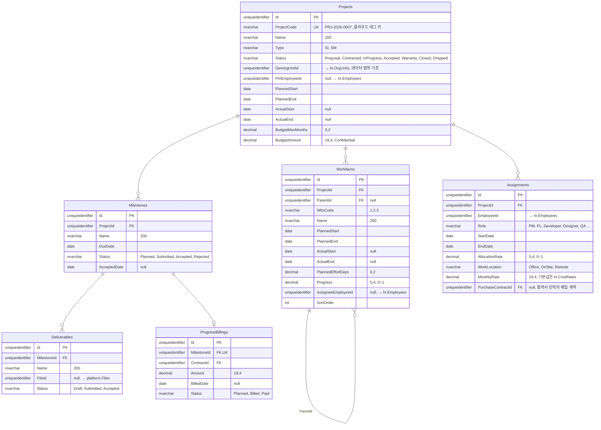

# ERD: projects

> 상태: 초안 · 갱신: 2026-10-21 · 업무 규칙: [projects.md](../../02-domain/projects.md) · DDL: [03-projects.sql](../ddl/03-projects.sql)

## 거래처와 계약

## 프로젝트, 일정, 투입

## 제약조건과 인덱스

| 테이블 | 내용 |
|---|---|
| `Clients`, `Partners` | `UX(Code)`. 사업자등록번호는 `UX(BusinessRegistrationNumber) WHERE IsDeleted = 0` (값이 있을 때) |
| `Contracts` | `UX(ContractNumber)`, `IX(CounterpartyType, CounterpartyId)` |
| `ContractAmendments` | `UX(ContractId, Seq)` |
| `ContractDocuments` | `UX(ContractId, Version)` |
| `Projects` | `UX(ProjectCode)`, `IX(OwningUnitId)` (데이터 범위 필터) |
| `WorkItems` | `UX(ProjectId, WbsCode)` |
| `Assignments` | `IX(EmployeeId, StartDate, EndDate)` (투입률 중복 검사, 가동 현황) |
| `Assignments` | CHECK: `AllocationRate > 0 AND AllocationRate <= 1`, `EndDate >= StartDate` |
| 임시 테이블 | `Contracts`, `ContractAmendments`, `PaymentTerms`, `Projects`, `Assignments` |
