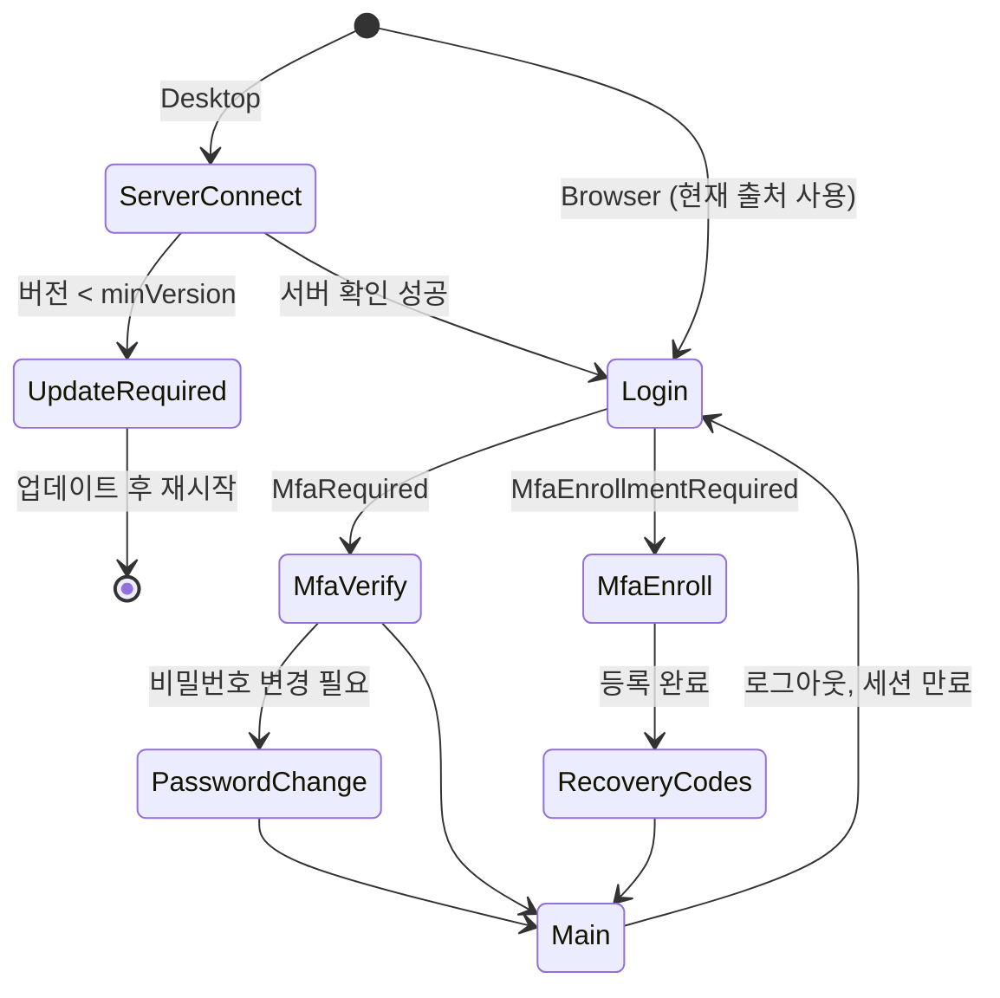

# Avalonia 클라이언트 규칙

> 상태: 초안 · 갱신: 2026-10-21 · 관련: [authentication.md](../03-security/authentication.md), [client-update.md](../01-architecture/client-update.md)

## 구조

```
Synthetix.Client/
├─ App.axaml
├─ Shell/                    # 메인 창, 메뉴, 탭, 알림 영역
├─ Features/                 # 서버 모듈과 같은 단위로 나눕니다
│  ├─ Auth/                  # ServerConnect, Login, MfaVerify, MfaEnroll, PasswordChange
│  ├─ Projects/
│  ├─ Hr/
│  ├─ Accounting/
│  └─ Ai/                    # 채팅 패널, AI 제안 검토 컴포넌트
├─ Api/                      # 서버 API 클라이언트 (Contracts 타입 사용), 인증 처리 DelegatingHandler
├─ Services/                 # ITokenStore, IUpdateService, IServerProfileStore, INavigationService ...
└─ Controls/                 # 공통 컨트롤 (금액 입력, 가린 값 표시, AI 제안 표시)
```

## 플랫폼별 구현

공통 프로젝트에는 인터페이스만 두고, 진입점 프로젝트에서 구현을 등록합니다.

| 인터페이스 | Desktop | Browser |
|---|---|---|
| `ITokenStore` | DPAPI로 암호화한 파일 (`%LocalAppData%\Synthetix`) | 메모리 (refresh는 HttpOnly 쿠키) |
| `IUpdateService` | Velopack | 아무것도 하지 않음 |
| `IServerProfileStore` | 최근 서버 목록 (로컬 파일) | 사용하지 않음 (현재 출처 고정) |
| `IFilePicker` | 네이티브 파일 대화상자 | 브라우저 파일 선택 |

## MVVM

- CommunityToolkit.Mvvm 소스 생성기를 씁니다: `[ObservableProperty]`, `[RelayCommand]`
- ViewModel 기준으로 화면을 이동합니다. `INavigationService`가 ViewModel을 받고, View는 `ViewLocator`가 찾아 연결합니다.
- 코드 비하인드(`.axaml.cs`)에는 UI 전용 코드만 둡니다. 예: 포커스, 애니메이션
- **컴파일된 바인딩**을 기본으로 씁니다(`AvaloniaUseCompiledBindingsByDefault=true`). 리플렉션 바인딩은 WASM 트리밍에서 깨질 수 있기 때문입니다.
- ViewModel은 Avalonia 타입을 참조하지 않습니다. 그래야 단위 테스트를 할 수 있습니다.

## 비동기와 WASM 제약

- 모든 I/O는 `async`로 하고, `CancellationToken`을 넘깁니다. `.Result`와 `.Wait()`는 쓰지 않습니다. WASM은 메인 스레드가 하나라서 바로 멈춥니다.
- 리플렉션 기반 JSON 직렬화를 쓰지 않습니다. Contracts의 `JsonSerializerContext`를 씁니다.
- 파일 시스템, 레지스트리, 프로세스 API는 플랫폼 서비스 인터페이스 뒤에 숨깁니다.

## 로그인 화면 흐름



| 화면 | 요소 |
|---|---|
| ServerConnect | Base URL 입력, 최근 서버 목록, "연결" 버튼. 확인에 성공하면 회사명을 보여줍니다 |
| Login | 회사명 표시, 사번, 비밀번호, "서버 변경" 링크(Desktop) |
| MfaVerify | 6자리 입력(붙여넣기 지원, 다 입력하면 자동 제출), "복구 코드 사용" 링크, 남은 시간 |
| MfaEnroll | QR 코드, 수동 입력용 키(공백으로 끊어 표시), 확인 코드 입력 |
| RecoveryCodes | 코드 10개, 복사·저장 버튼, "보관했습니다" 체크 후 진행 |

## 조직도 컨트롤 (OrgChart)

요구사항은 [organization.md](../02-domain/organization.md)에 있습니다. 구현 방침은 다음과 같습니다.

- **레이아웃 계산과 그리기를 나눕니다.**
  - `TreeLayoutEngine`: Avalonia에 의존하지 않는 순수 C#입니다. 노드 크기와 트리를 받아 좌표를 돌려줍니다. Buchheim-Walker 알고리즘(O(n))에 "팀 구성원 세로 쌓기" 규칙을 더합니다. 단위 테스트 대상입니다.
  - `OrgChartControl`: 계산된 좌표에 노드 카드(DataTemplate)와 연결선을 그립니다. 확대·축소와 화면 이동은 PanAndZoom 컨트롤 안에서 처리합니다.
- 서버에서 받은 평평한 노드 목록으로 클라이언트가 트리를 만듭니다. 접힌 노드의 하위는 펼칠 때 요청합니다.
- 노드가 많을 때(수백 개 이상)는 화면 밖의 노드를 그리지 않는 가상화를 검토합니다. 대상 규모(500명)라면 접기만으로도 충분할 것으로 예상합니다 (확인 필요).
- 편집 모드에서 드래그해서 놓으면 서버에 "개편안 변경 항목 추가"를 요청합니다. 화면은 서버가 돌려준 미리보기로 다시 그립니다. 클라이언트가 규칙을 따로 검증하지 않습니다.
- PNG 내보내기는 `RenderTargetBitmap`으로 합니다. Browser에서도 되는지 확인이 필요합니다.
- 키보드 접근성: 화살표 키로 노드 사이를 이동하고, Enter로 상세 패널을 엽니다.

화면 구성: **조직·권한 관리** 화면 하나에 왼쪽은 조직도, 오른쪽은 상세 패널(구성원, 부여된 역할, 유효 권한 탭)을 둡니다. 조직 구조와 권한 설정을 같은 화면에서 다룹니다.

## UI 공통 규칙

- 테마는 Fluent를 쓰고, 다크 모드를 지원합니다.
- 화면 문구는 리소스 파일(`ko-KR`)로 관리합니다. 다국어는 나중에 지원합니다.
- 금액, 날짜, 투입률은 공통 컨트롤로 입력하고 표시합니다. 금액은 천 단위 구분 기호를 쓰고, 날짜는 `yyyy-MM-dd` 형식입니다.
- 가린 값(`Restricted`)은 공통 컨트롤로 표시합니다. 원문 보기 버튼은 권한이 있을 때만 나타나고, 누르면 열람 사유를 입력하는 창이 뜹니다.
- **AI가 만든 값은 시각적으로 구분합니다.** 아이콘과 배경색으로 표시하고, 근거 보기와 채택·수정·거절 동작을 붙입니다.
- 오류는 ProblemDetails의 `code`를 보고 사용자 메시지에 연결합니다.
